# Nenjam Matrimony — Developer Handbook

> **Read-only artifact.** This document was generated by inspecting the repository as it exists today. It does not modify code. Where the underlying code is ambiguous or genuinely unconfirmed, it is marked **"Needs verification"** rather than guessed.
>
> **Scope note on folder casing**: earlier project notes referenced a capitalized `Backend/` folder as distinct from `backend/`. On inspection there is only **one** backend directory, tracked by git as `backend/` (lowercase). Treat all references to "Backend" in this document as that single folder.

**Generated:** 2026-07-11 · **Repo root:** `c:\Users\PC\nenjam_matrimony_app`

---

## Table of Contents

1. [Overview](#1-overview)
2. [Tech Stack](#2-tech-stack)
3. [Repository Structure](#3-repository-structure)
4. [Frontend Architecture](#4-frontend-architecture)
5. [Backend Architecture](#5-backend-architecture)
6. [Database Design](#6-database-design)
7. [User Journey](#7-user-journey)
8. [Registration Wizard](#8-registration-wizard)
9. [Profile Intelligence](#9-profile-intelligence)
10. [Authentication](#10-authentication)
11. [API Documentation](#11-api-documentation)
12. [State Management](#12-state-management)
13. [Navigation](#13-navigation)
14. [Configuration](#14-configuration)
15. [Assets](#15-assets)
16. [Current Features](#16-current-features)
17. [Known Technical Debt](#17-known-technical-debt)
18. [Backend ↔ Frontend Integration Status](#18-backend--frontend-integration-status)
19. [Production Readiness](#19-production-readiness)
20. [Folder Ownership](#20-folder-ownership)
21. [Development Workflow](#21-development-workflow)
22. [Troubleshooting](#22-troubleshooting)
23. [Future Roadmap](#23-future-roadmap)
24. [Architecture Diagrams (Index)](#24-architecture-diagrams-index)
25. [Completion Summary & Launch Plan](#25-completion-summary--launch-plan)

---

## 1. Overview

**Nenjam Matrimony** ("Where Hearts Meet") is a premium Indian matrimony app. The product combines a traditional matrimony registration flow (12-step profile wizard: basics, religion, language, location, education, physical, lifestyle, family, horoscope, partner preference, photos, verification) with a newer **"Relationship Intelligence"** layer — Hinge-style profile prompts, an OCEAN Big-Five personality quiz, and Vedic horoscope compatibility scoring — designed to differentiate it from generic matrimony sites on match quality rather than just filters.

**Business goals** (inferred from code structure, not a product doc — **needs verification** against actual product requirements):
- Premium/trust-first matrimony positioning (verification badges, trust score, KYC/face verification modeled in the DB).
- Subscription monetization (Silver/Gold tiers, seeded in `SubscriptionPlan`).
- Differentiated matching via personality + astrology compatibility, not just demographic filters.
- Tamil-first localization with a roadmap to 10 Indian languages.

**Target users**: Indian matrimony seekers and their families (the wizard has a "Profile created for: Myself / Son / Daughter / ..." selector), primarily Tamil-speaking initially (`en`/`ta` are the only shipped languages).

**Current MVP stage**: **Pre-launch, single-vertical-slice backend.** The Flutter app is visually complete across most screens, but only **one backend vertical (`profiles` — the registration wizard)** is wired end-to-end. Everything else — auth issuance beyond Firebase, matching, chat, search, subscriptions/payments, notifications, admin — is either frontend-mock-only or backend-scaffold-only (empty NestJS classes, not registered in `AppModule`). See [§18](#18-backend--frontend-integration-status) for the full per-feature matrix.

**Current completion %**: see [§25](#25-completion-summary--launch-plan) for the full breakdown — headline figures: **Frontend UI ~75%**, **Backend ~15%** (one working module of 15), **Database schema ~90%** (modeled but under-used), **overall production readiness ~20%**.

**Future roadmap**: see [§23](#23-future-roadmap).

---

## 2. Tech Stack

| Layer | Technology | Version | Why it's here |
|---|---|---|---|
| Mobile client | **Flutter** | Dart SDK `^3.9.2` | Single codebase for Android/iOS; the entire client is Flutter, no native modules found. |
| State management | **Riverpod** (`flutter_riverpod` + `hooks_riverpod`) | `^2.6.1` | Compile-safe DI + reactive state without `BuildContext`-scoped `Provider` boilerplate; used for every repository, controller, and async data source in the app (30 providers, see [§12](#12-state-management)). `riverpod_generator`/`riverpod_annotation` are present in `pubspec.yaml` but **unused** — all providers are hand-written, not code-generated. |
| Routing | **go_router** | `^14.8.1` | Declarative, deep-link-capable routing with a `ShellRoute` for the persistent bottom nav and standalone routes for everything else (registration, settings, etc.). |
| Networking | **Dio** | `^5.7.0` | HTTP client with interceptor support — used to attach Firebase ID tokens, log requests, and normalize error messages ([§4.8](#48-core-network-layer)). |
| Auth (client) | **Firebase Auth** (`firebase_auth`) | `^6.5.4` | Sole identity provider — email/password **and** phone OTP. No Firestore, Storage, Messaging, Crashlytics, or Analytics packages are present; Firebase is deliberately auth-only here (see `auth-architecture.md` at repo root). |
| Local storage | **shared_preferences** | `^2.3.4` | Theme, language, onboarding flags, nav-state-restoration snapshot, the Improve-Profile-prompt one-time flag. |
| Env config | **flutter_dotenv** | `^5.2.1` | Loads `.env.<environment>` files; see [§14](#14-configuration) for the environment-switching caveat. |
| UI toolkit | **google_fonts**, **flutter_screenutil**, **cached_network_image**, **flutter_svg**, **shimmer**, **flutter_animate** | various | Poppins/Inter typography without bundling font files; responsive scaling; image caching; loading skeletons; micro-animations. |
| Backend framework | **NestJS** | `^11` | Modular, DI-based Node framework; deployed as a **4-app monorepo** (`api`, `worker`, `scheduler`, `websocket`) sharing 9 internal libraries (`@app/*`). Only `api` has real logic today. |
| ORM | **Prisma** (`@prisma/client` + `@prisma/adapter-pg`) | — | Type-safe DB access via a driver-adapter (not the default Prisma query engine binary) against Postgres. 28 models, 18 enums (see [§6](#6-database-design)). |
| Database | **PostgreSQL** | — | Primary datastore for the entire domain model — profiles, chat, subscriptions, verification, astrology, psychology, trust score, admin, audit log. |
| Cache | **Redis** (`ioredis`) | `^5` | **Connected and health-checked, but not functionally used yet** — no caching, session, or pub/sub calls exist in any real service. |
| Search | **Elasticsearch** (`@elastic/elasticsearch`) | `^7.17` | Same status as Redis: connected/health-checked, an index mapping file exists (`profile-index.mapping.ts`), but `SearchModule` itself is an empty stub — nothing indexes or queries it yet. |
| Queue | **BullMQ** | *(not installed)* | Referenced extensively in code comments and folder scaffolding (`libs/queue`, worker processors) but `bullmq`/`@nestjs/bullmq` are **not in `package.json`** — 100% aspirational today. |
| Package manager (backend) | **pnpm** | — | `pnpm-workspace.yaml` present; NestJS CLI "monorepo mode" (`nest-cli.json`) drives the apps/libs structure, not pnpm workspace `packages:` globs. |
| Auth (server) | **firebase-admin** | `^14` | Verifies Firebase ID tokens server-side and just-in-time provisions the internal `User` row ([§10](#10-authentication)). |
| Validation | **class-validator** / **class-transformer** via Nest's `ValidationPipe` | — | The actually-active validation mechanism. A parallel `ZodValidationPipe` exists in `libs/common` but is an **unimplemented stub** — `zod` is not exercised anywhere. |
| Payments | **Razorpay** (backend: `razorpay-webhook.controller.ts`) vs **Stripe** (frontend: `STRIPE_PUBLISHABLE_KEY` in `.env.example`) | *(neither installed/wired)* | ⚠️ **Needs verification** — the two sides of the codebase reference two different payment providers. Subscription/payment flow is entirely stubbed on both ends, so this hasn't caused a real conflict yet, but it should be resolved before building checkout. |
| Storage | AWS S3 (`libs/storage/s3.service.ts`, `cloudfront.service.ts`) | *(stub)* | Referenced for photo storage (`ProfilePhoto.s3Key`/`cdnUrl` fields exist in Prisma) but `S3Service` is confirmed an empty stub; `aws-sdk`/`@aws-sdk/client-s3` are not in `package.json`. |
| Docs export reference | Stitch design export (`nenjam ui/`) | — | An HTML+PNG design reference tree at the repo root, used as the visual source of truth while building Flutter screens (see `Frontend/README.md`'s instructions to read it before implementing UI). Not part of the buildable app. |

---

## 3. Repository Structure

```text
nenjam_matrimony_app/
├── Frontend/                      # Flutter app (Dart)
│   ├── lib/
│   │   ├── main.dart               # App entrypoint (see §4.1)
│   │   ├── bootstrap.dart          # Vestigial/near-duplicate entrypoint — not called by main.dart (see §17)
│   │   ├── core/                   # Cross-feature infrastructure (theme, network, router, services, widgets)
│   │   ├── features/                # One folder per vertical slice (see §4.10 for the full inventory)
│   │   └── l10n/                    # ARB source + generated AppLocalizations
│   ├── assets/                     # Icons/images/svg/animations/lottie/illustrations — mostly .gitkeep placeholders
│   ├── android/, ios/               # Platform shells (default/template config, not yet customized)
│   ├── test/                        # Single smoke test only (see §17)
│   ├── pubspec.yaml
│   ├── l10n.yaml
│   └── README.md                    # Default `flutter create` README + a short Stitch-design-first note
│
├── backend/                       # NestJS monorepo (TypeScript) — git-tracked as lowercase `backend/`
│   ├── apps/
│   │   ├── api/                    # ★ The only app with real logic — REST API, port 3000
│   │   ├── worker/                 # Stub — BullMQ processors not yet installed
│   │   ├── scheduler/              # Stub — cron jobs not yet installed
│   │   └── websocket/              # Stub — chat gateway not yet installed, port 3001
│   ├── libs/                       # Shared libraries, imported as `@app/<name>`
│   │   ├── database/                # Prisma schema, migrations, seeders, PrismaService
│   │   ├── common/                  # Guards, decorators, filters, interceptors, pipes (mostly stubs, see §17)
│   │   ├── config/                  # AppConfigModule/Service + Joi env validation
│   │   ├── firebase/                 # FirebaseService (Admin SDK wrapper) — real, implemented
│   │   ├── cache/                    # RedisService — real connection, unused for actual caching
│   │   ├── search/                   # ElasticsearchService — real connection, unused for actual search
│   │   ├── queue/                    # Empty scaffolding — BullMQ not installed
│   │   ├── logger/                   # LoggerService — empty stub
│   │   └── storage/                  # S3Service/CloudFrontService — stubs
│   ├── package.json                 # Single root package.json for the whole backend (no per-app package.json)
│   ├── nest-cli.json                 # Defines the 4 apps + 9 libs monorepo-mode project map
│   ├── pnpm-workspace.yaml
│   ├── .env.example
│   └── README.md                     # Default NestJS CLI starter README (not project-specific)
│
├── nenjam ui/                      # Stitch design export (HTML/PNG reference), NOT part of the app — see §17
├── auth-architecture.md            # Root-level design doc: Firebase-auth-only architecture decision
├── registration-wizard-integration.md  # Root-level design doc: wizard↔backend integration notes
└── PROJECT_DOCUMENTATION.md        # This file
```

### Frontend `lib/` internal layout

Each `features/<name>/` folder follows (where implemented) a light clean-architecture split:

```text
features/<name>/
├── domain/
│   ├── models/            # Plain Dart data classes (no codegen — hand-written fromJson/toJson/copyWith)
│   └── repositories/       # Abstract repository interfaces (newer features only — see §9)
├── data/
│   └── repositories/        # Concrete implementations — Mock*/Api* pairs for newer features, single Impl for older ones
└── presentation/
    ├── providers/            # Riverpod providers/notifiers
    ├── pages/                 # Screen widgets
    └── widgets/                # Feature-local widgets
```

`core/` holds everything cross-cutting:

```text
core/
├── config/            # AppConfig, AppEnvironment, per-environment Firebase options
├── constants/          # AppConstants, AppSpacing
├── network/             # ApiClient, ApiEndpoints, interceptors, api_providers.dart
├── providers/            # locale_provider.dart
├── router/                # app_router.dart, route_names.dart
├── services/               # storage_service.dart (the only file here — see §4.9)
├── theme/                   # app_colors/typography/decorations/gradients/shadows/theme.dart, tokens/
└── widgets/                  # Shared design-system widgets (buttons, cards, chips, navigation, relationship_intelligence/)
```

### Backend `apps/api/src/modules/<name>/` internal layout

Every module (real or stub) follows the same generated scaffold shape:

```text
modules/<name>/
├── <name>.module.ts
├── controllers/
├── services/
├── repositories/
├── entities/
├── dto/
├── guards/ | pipes/ | jobs/ | events/ | listeners/ | decorators/   # module-specific, varies
└── tests/                # *.spec.ts, mostly it.todo() placeholders
```

Only `modules/profiles/` has non-empty implementations in every one of these folders; all 14 sibling modules are fully-scaffolded but empty (see [§17](#17-known-technical-debt)).

---

## 4. Frontend Architecture

### 4.1 Bootstrap sequence

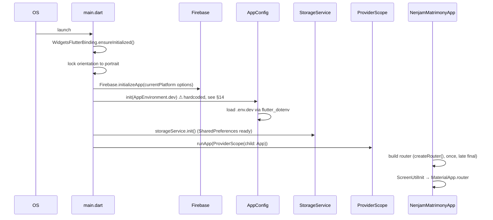

`NenjamMatrimonyApp` (in `main.dart`) is more than a root widget — it's also the app-lifecycle observer:
- Debounces (400ms) and persists nav state (current route + registration draft snapshot) on every route change and on `AppLifecycleState.paused`, so a killed process can resume mid-wizard (see [§7.2](#72-splash--session-resolution)).
- On `resumed`, re-checks the Firebase session and force-navigates to `/login` if it dropped while backgrounded.
- Listens for any sign-out (`authStateChangesProvider`) and resets `registrationProvider` + clears nav state, preventing draft-state leakage across accounts on a shared device.
- **No global crash handler** (`FlutterError.onError`/`PlatformDispatcher.onError`) is configured — uncaught errors are not centrally reported.

> **Needs verification / cleanup flag**: `lib/bootstrap.dart` defines a second, near-duplicate `bootstrap()`/`NenjamMatrimonyApp` that nothing calls except `core/network/api_client.dart` importing it solely for the `appConfig` global. Treat `main.dart` as the sole real entrypoint.

### 4.2 Routing

Built once via `createRouter()` in `core/router/app_router.dart` (`initialLocation: '/'`). Two navigator keys: a root key and a shell key for the bottom-nav `ShellRoute`. Full route table is in [§13](#13-navigation).

There is **no `redirect:` callback on `GoRouter` itself** — no centralized route guard. Auth gating is procedural: `SplashController.resolveInitialRoute()` decides the first screen, and `NenjamMatrimonyApp._checkSessionOnResume()` force-navigates to `/login` on resume if signed out. **A deep link straight into a protected route would not be blocked by the router layer** — flag this for security review before shipping deep linking.

### 4.3 State management

Riverpod is used exclusively — no `Provider` package, no Bloc, no GetX. See the full 30-provider inventory in [§12](#12-state-management). The dominant patterns:
- **`Provider`** for DI (repositories, services, API client) — the majority.
- **`NotifierProvider`** for anything with mutation methods (login/signup controllers, the registration draft, the personality quiz state machine).
- **`FutureProvider.autoDispose`** for one-shot async reads (profile prompts, personality result, horoscope summary) — consistently `autoDispose` so screens re-fetch fresh data each visit rather than caching stale mock/API state indefinitely.
- **`StreamProvider`** for the single Firebase auth-state stream.

### 4.4 Repository pattern

Two generations of the pattern coexist:

1. **Older features** (registration, authentication, discover): one concrete repository class per feature, directly wrapping `ApiClient` or a mock data source, exposed via a single `Provider`.
2. **Newer features** (`profile_prompts`, `psychology`, `astro`'s compatibility layer): an **abstract repository interface** in `domain/repositories/`, with **both** a `Mock*Repository` (in-memory, default-wired) and an `Api*Repository` (calls the real endpoint, built but not wired as the active provider) in `data/repositories/`. Swapping from mock to real backend is a one-line change to the `Provider` override — no UI changes needed. See [§9](#9-profile-intelligence) for why this pattern was chosen and exactly which provider to flip when the backend team ships real endpoints.

### 4.5 Authentication flow

Full detail in [§10](#10-authentication). Summary: Firebase Auth (email/password + phone OTP) is the sole identity provider; the Flutter app never talks to a custom `/auth/*` backend endpoint (those `ApiEndpoints` constants exist but are unused legacy). Every backend call carries a Firebase ID token via `AuthInterceptor`.

### 4.6 Registration flow

Full detail in [§8](#8-registration-wizard). Summary: a single `ProfileWizardPage` renders all 12 steps from one `ProfileDraft` aggregate held in `registrationProvider` (`NotifierProvider`, `keepAlive`), synced to the backend one PATCH per step on "Continue," reviewed on `ProfileReviewPage`, and finalized via `POST /profiles/finalize`. The same two screens serve both **CREATE** (new signup) and **EDIT** (from the drawer) modes, gated by `profileFlowModeProvider`.

### 4.7 Drawer & bottom navigation

**Bottom nav** (`core/widgets/navigation/app_bottom_nav.dart`, `AppBottomNavShell`) — a floating pill-style bar, **5 tabs**: Discover, Matches, Messages, Astro, Premium. Search/Notifications/Profile share the shell's `ShellRoute` (for consistent back-button behavior) but are reached by push, not tab icons — they are not visible tab items.

**Drawer** (`features/discover/presentation/widgets/nenjam_navigation_drawer.dart`, `NenjamNavigationDrawer`) — 78%-width slide-out panel: compact profile header → profile-strength progress bar → grouped menu (Profile / Match Activity / Settings / Logout) → premium upsell strip → footer. Current callback surface (17 tap handlers): My Profile, Edit Profile, **Profile Intelligence** (new, see [§9](#9-profile-intelligence)), Verification Center, Trust Score, Visitors, Interest Sent/Received, Shortlist, Language, Settings, Privacy, Help, Logout, Upgrade, Complete-Profile, Rate Us.

### 4.8 Core network layer

`ApiClient` (`core/network/api_client.dart`) wraps a Dio singleton:
- `baseUrl`: from `.env.dev` → `http://192.168.168.109:3000` (a LAN IP — **a real device/emulator must be on the same network as the dev machine running the backend**; see [§22](#22-troubleshooting)).
- Timeouts: 15s connect, 30s send/receive.
- `validateStatus: status < 500` — 4xx responses resolve normally rather than throwing, so callers must check status codes themselves.
- Interceptor chain: `AuthInterceptor` (injects `Authorization: Bearer <Firebase ID token>`) → `LoggingInterceptor` → a **verbose debug `LogInterceptor`** (flagged in-code as temporary, logs full request/response bodies) → `ErrorInterceptor` (maps Dio/HTTP errors to user-facing messages).

`ApiEndpoints` (`core/network/api_endpoints.dart`) groups constants by feature. Only the **Registration wizard** and **Relationship Intelligence** groups are confirmed wired to a live, reachable backend today; everything else (Auth, Profile-beyond-registration, Search, Matches, Chat, Notifications, Subscription, Verification, Settings, Support) is defined but aspirational — the corresponding Flutter features are still mock-data UI. Full endpoint table in [§11](#11-api-documentation).

### 4.9 Core services

`core/services/` contains exactly one file: `storage_service.dart` (`StorageService`, wrapping `SharedPreferences`). It is the single local-persistence surface for the whole app: theme, language, onboarding flag, legacy access/refresh tokens (unused by the real Firebase-based auth interceptor), pending signup phone, nav-state restoration (4 keys), notification preference, and the Relationship-Intelligence one-time prompt flag. Everything else that looks like a "service" (Firebase auth service, backend-sync service, token service) actually lives inside `features/authentication/data/services/`, not `core/services/`.

### 4.10 Feature module inventory

| Feature | Status |
|---|---|
| `authentication` | ✅ Fully implemented — Firebase email + phone auth |
| `registration` | ✅ Fully implemented — 12-step wizard, wired to real backend |
| `splash` | ✅ Fully implemented — session-restore controller |
| `onboarding` | ✅ Fully implemented — animated 3-slide carousel |
| `language` | ✅ Fully implemented |
| `discover` | ✅ UI complete, backed by `DiscoverMockDataSource` (no live API) |
| `profile` | ✅ Fully implemented — pulls live Relationship Intelligence sections |
| `profile_prompts` / `psychology` / `astro` (compatibility layer) / `profile_intelligence` | ✅ Fully implemented (mock-repository architecture — see [§9](#9-profile-intelligence)) |
| `matches` | 🟡 Substantial UI (812 lines), mock data, no backend provider |
| `settings` | 🟡 Real logout flow; dark-mode/notification switches are no-ops |
| `verification` | 🟡 Static mock UI — no real upload/API call |
| `premium` | 🟡 Static mock UI — hardcoded plan cards |
| `search` | 🟡 Static mock UI — hardcoded grid |
| `chat` | 🟡 Static mock UI — hardcoded conversation list |
| `notifications` | 🟡 Static mock UI — hardcoded list |
| `subscription` | 🟡 Explicit placeholder — "Proceed to Payment" just navigates to Discover |
| `help` | 🟡 Static mock UI — hardcoded FAQ |
| `interests`, `privacy`, `shortlist`, `trust_score`, `visitors` | 🔴 "Coming Soon" placeholder pages only |

(✅ = implemented UI; 🟡 = UI built but mock/no-op; 🔴 = bare placeholder. This table is UI-completeness only — see [§18](#18-backend--frontend-integration-status) for backend-paired status.)

---

## 5. Backend Architecture

### 5.1 Monorepo shape

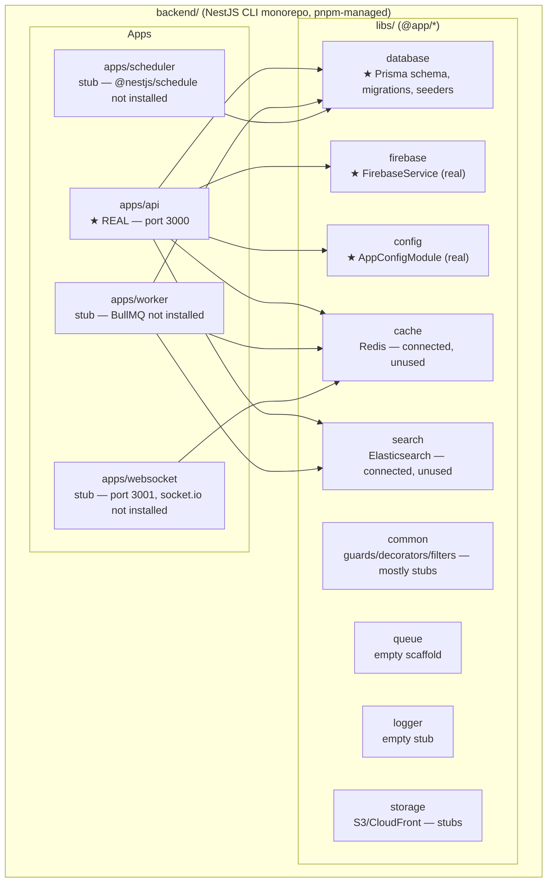

### 5.2 `apps/api` module map

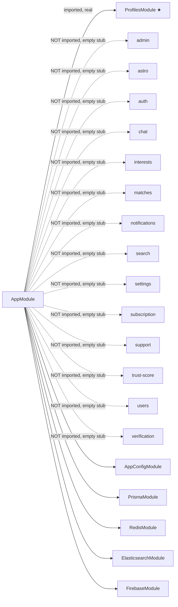

**Note**: there is no `psychology` module folder in `apps/api/src/modules` at all, despite `PsychologyQuiz`/`QuizQuestion`/`UserQuizResponse` existing (and being seeded) in Prisma — the Flutter Relationship Intelligence quiz has no real backend endpoint to eventually call yet; a future `ApiPersonalityRepository` swap-in would need this module built first.

### 5.3 Request lifecycle (authenticated request)

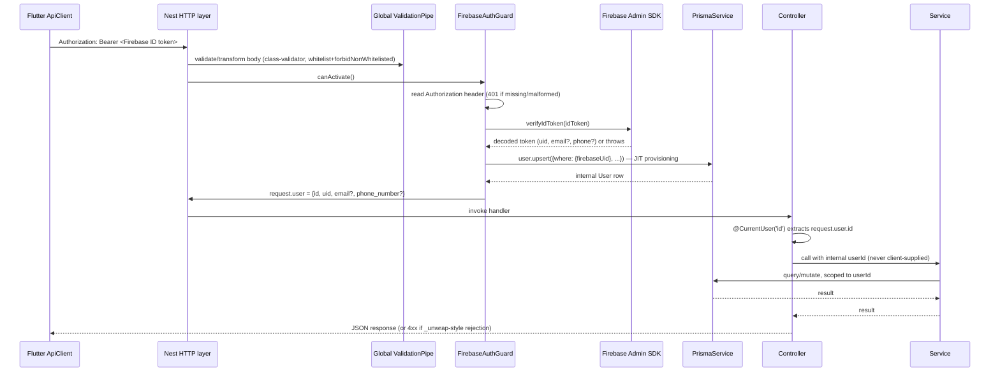

There is **no global exception filter** actually registered (`AllExceptionsFilter` is an unimplemented stub) — Nest's default built-in exception handling is what's live today. There is **no structured logger** (`LoggerService` is an empty stub) — individual services use Nest's built-in `Logger` directly for their own startup/error logging.

### 5.4 `ProfilesModule` — the one real vertical

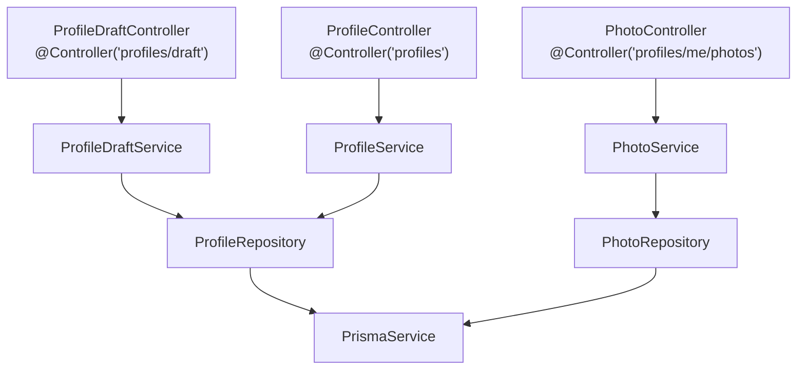

- `ProfileDraftController` — `GET /profiles/draft` + 10× `PATCH /profiles/draft/<section>` (one per wizard step 0-9), delegating to `ProfileDraftService.updateSection(userId, sectionKey, dto)`.
- `ProfileController` — `GET /profiles/me`, `POST /profiles/finalize` (idempotent — maps the accumulated draft into `UserProfile`/`AstrologyProfile`/`PartnerPreference`).
- `PhotoController` — `GET`/`POST /profiles/me/photos` — **metadata only**; there is no wired file-upload path (no presigned-URL endpoint, no direct multipart handler) — S3 upload is not implemented.

All routes are `@UseGuards(FirebaseAuthGuard)`. Full endpoint-by-endpoint table in [§11](#11-api-documentation).

### 5.5 Validation

Nest's global `ValidationPipe` (`whitelist: true, transform: true, forbidNonWhitelisted: true`, registered in `apps/api/src/main.ts`) + `class-validator`/`class-transformer` decorators on DTOs is the **actual** mechanism. A parallel `ZodValidationPipe` exists in `libs/common/src/pipes/` but is an unimplemented stub — do not build against it; `zod` is not exercised anywhere in the codebase.

### 5.6 Caching, search, queueing — status

| Infra | Connected? | Actually used for anything? |
|---|---|---|
| Redis (`libs/cache`) | ✅ Yes — pings on module init, dev-lenient/prod-strict failure handling | ❌ No `.get`/`.set` calls anywhere in real services |
| Elasticsearch (`libs/search`) | ✅ Yes — same health-check pattern, plus a `profile-index.mapping.ts` mapping file | ❌ `SearchModule` is an empty stub — nothing indexes or queries it |
| BullMQ (`libs/queue`) | ❌ No — package not installed | ❌ All producer/processor files are TODO stubs |

### 5.7 Backend `package.json` scripts

See [§21](#21-development-workflow) for the full command reference.

---

## 6. Database Design

### 6.1 Entity-Relationship Diagram

This covers the core domain (User + the currently-live registration data + the modeled-but-unused Relationship Intelligence tables). Peripheral tables (chat, subscriptions, support, admin, audit) are summarized in the table below rather than the diagram, to keep it legible.

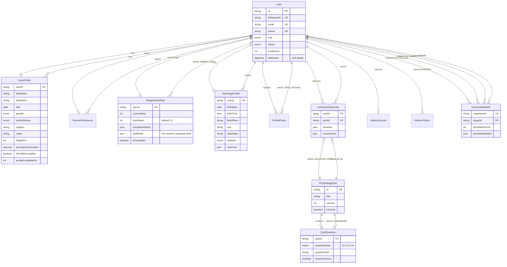

### 6.2 Full table reference

| Model | Purpose | Key relationships | Notable indexes |
|---|---|---|---|
| **User** | Identity root; mirrors the Firebase account into Postgres | Hub for ~20 relations (see ERD) | `firebaseUid`, `email`, `phone`, `status`, `role`, `deletedAt`, `createdAt` |
| **RefreshToken** | JWT refresh-token store (hashed, single-use per doc comment) | `userId` | — | ⚠️ **Modeled but unused** — no service reads/writes it (see [§10](#10-authentication)) |
| **AdminAccount** | 1:1 admin extension of `User` | `userId` | — |
| **UserProfile** | The core matrimonial profile (finalized, post-wizard) | `userId` | Composite `[gender, religion, caste, annualIncomeLakhs]` + singles on gender/religion/caste/heightCm/income/city/state — clearly built for search/filter queries |
| **ProfilePhoto** | Uploaded photo metadata | `userId` | — |
| **PartnerPreference** | What the user is looking for in a match | `userId` (1:1) | — |
| **RegistrationStep** | The 12-step wizard's live draft state | `userId` (1:1) | `draftData` JSON backs every `PATCH /profiles/draft/*` call — see [§8](#8-registration-wizard) |
| **AstrologyProfile** | Birth chart data | `userId` (1:1) | — |
| **HoroscopeMatch** | Cached 2-person Porutham/Guna compatibility score | `requesterId`, `targetId` (two named `User` relations) | Unique `[requesterId, targetId]` |
| **PsychologyQuiz** | OCEAN quiz definition (versioned) | 1:many `QuizQuestion`, `UserQuizResponse` | — | Seeded: "OCEAN Personality Profile" v1.0, 20 questions |
| **QuizQuestion** | One Likert question, tagged to an OCEAN domain | `quizId` | — |
| **UserQuizResponse** | A user's completed quiz attempt + computed score | `userId`, `quizId` | Unique `[userId, quizId]` |
| **SubscriptionPlan** | Silver/Gold tier definitions | — | Unique `name`; seeded (₹499/30-day Silver, ₹999/90-day Gold) |
| **UserSubscription** | A user's active/past subscription | `userId`, `planId` | — |
| **PaymentTransaction** | Payment attempt/result | `userId`, `subscriptionId` | Unique `razorpayOrderId`, `razorpayPaymentId` |
| **ChatRoom** | 1:1 conversation between two users | `user1Id`, `user2Id` | Unique `[user1Id, user2Id]` |
| **ChatMessage** | A message within a room | `roomId`, `senderId` | — |
| **MessageReaction** | Emoji reaction on a message | `messageId`, `userId` | Unique `[messageId, userId]` |
| **KycVerification** | ID document verification | `userId` | `docNumber` documented as "store encrypted — never log" |
| **FaceVerification** | Selfie liveness/face-match | `userId` (1:1) | — |
| **TrustScoreLog** | Audit trail of trust-score deltas | `userId` | — |
| **Notification** | In-app/push notification record | `userId` | 10-value `NotificationType` enum |
| **DevicePushToken** | FCM token per device | `userId` | Unique `fcmToken` |
| **UserReport** | User-reports-user | `reporterId`, `reportedUserId` | — |
| **UserBlock** | User blocks user | `blockerId`, `blockedUserId` | Unique `[blockerId, blockedUserId]` |
| **SupportTicket** | Help/support request | `userId` | — |
| **AuditLog** | Admin/system action trail | `actorId` (loose string, **not** an FK) | — |

**18 enums** total: `UserRole`, `UserStatus`, `Gender`, `MaritalStatus`, `DoshamType`, `InterestStatus`, `OceanDomain`, `SubscriptionPlanName`, `SubscriptionStatus`, `PaymentStatus`, `MessageType`, `KycDocType`, `VerificationStatus`, `NotificationType`, `DevicePlatform`, `ReportReason`, `ReportStatus`, `SupportStatus`.

Cascading deletes (`onDelete: Cascade`) are used consistently on every child→`User` FK — no `Restrict`/`SetNull` usage. Prisma client is generated to `backend/libs/database/generated/client` (committed alongside source, not `node_modules`), using `@prisma/adapter-pg` (driver-adapter mode) rather than the default Prisma engine binary.

### 6.3 Migrations (chronological)

| # | Migration | What it did |
|---|---|---|
| 1 | `20260707062025_init` | Full initial schema — all 18 enums, all 28 tables, all indexes, in one shot (877 lines) |
| 2 | `20260708141027_add_registration_step_draft_data` | Adds `RegistrationStep.draftData JSONB DEFAULT '{}'` |
| 3 | `20260709123316_sync_existing_schema` | **Drops** that same `draft_data` column ("data will be lost" warning) |
| 4 | `20260709124607_add_registration_draft_data` | Re-adds the identical `draft_data` column |

Migrations 2-4 read as a false-start/correction cycle around one field during active development — the **end state matches current `schema.prisma`**, so no action is needed, but it's worth knowing this history if you ever need to `prisma migrate reset` against a database that has an intermediate migration applied.

### 6.4 Seed data

`pnpm db:seed` (`backend/libs/database/src/seed.ts`) runs 3 upsert-based (safe to re-run) seeders:
- **`plans.seeder.ts`** — Silver (₹499, 30 days, capped limits) and Gold (₹999, 90 days, unlimited via `-1` sentinels) `SubscriptionPlan` rows.
- **`quiz.seeder.ts`** — the OCEAN quiz (20 questions, 4 per trait, reverse-scoring flags set).
- **`admin.seeder.ts`** — one default `ADMIN` user. ⚠️ Uses a **placeholder Firebase UID** (`admin-seed-placeholder-uid-001`) — a real Firebase Console account must be created and the UID swapped in before this admin login is usable.

### 6.5 Tables that exist but have no API surface yet

`PsychologyQuiz`/`QuizQuestion`/`UserQuizResponse` (seeded, no backend module), `HoroscopeMatch` (no astro module logic), most of chat/subscription/verification/notifications/admin/support/trust-score — modeled and migrated, but nothing reads/writes them via HTTP today because the owning NestJS modules are unregistered stubs (see [§5.2](#52-appsapi-module-map)).

---

## 7. User Journey

### 7.1 Complete flow (new user)

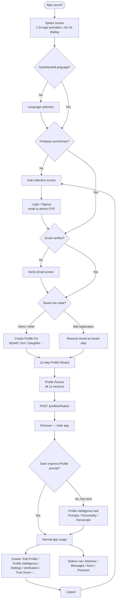

### 7.2 Splash & session resolution

Precedence order inside `SplashController.resolveInitialRoute()`:
1. No language selected → `/language`.
2. No Firebase `currentUser` → clear nav state → `/auth-selection`.
3. `syncUserWithBackend()` fires (unawaited, fire-and-forget — just JIT-provisions the backend `User` row).
4. Email not verified (phone-OTP verification is currently **disabled** in this check — email-only gating; a network error here also falls through to the verify-email screen rather than blocking) → `/verify-email`.
5. Otherwise, resolve a saved route from `StorageService`: if it was `registrationWizard`/`profileReview`, restore the exact `ProfileDraft` + step + flow-mode and resume there; if it was one of the 5 "restorable tab routes" (discover/matches/messages/astro/premium), return straight there; otherwise fall back to `/discover`.

### 7.3 Navigation graph (post-login)

See [§13](#13-navigation) for the full route table. High level:

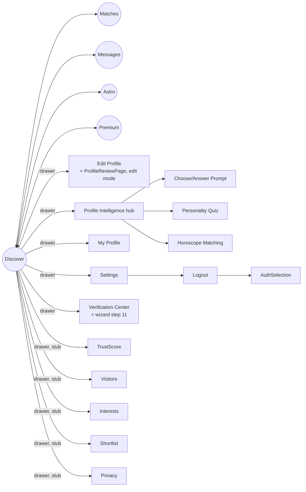

---

## 8. Registration Wizard

Single `ProfileWizardPage` (`features/registration/presentation/pages/`) renders all **12 steps** (indices 0-11) via a `switch` on `currentStep`, with an `AnimatedSwitcher` transition, a top progress bar, and Back/Continue buttons. State lives in `ProfileDraft` (`registration/domain/models/profile_draft.dart`), held by `registrationProvider` (`NotifierProvider<RegistrationNotifier, ProfileDraft>`, `keepAlive: true`).

| # | Step | Widget | Draft sub-model | Backend PATCH endpoint | Synced on Continue? |
|---|---|---|---|---|---|
| 0 | Basic Details | `step_basic_info.dart` | `BasicDetails` | `/profiles/draft/basic-details` | ✅ |
| 1 | Religion | `step_religion.dart` | `ReligionDetails` | `/profiles/draft/religion-details` | ✅ |
| 2 | Language | `step_language.dart` | `LanguageDetails` | `/profiles/draft/language-details` | ✅ |
| 3 | Location | `step_location.dart` | `LocationDetails` | `/profiles/draft/location-details` | ✅ |
| 4 | Education | `step_education.dart` | `EducationDetails` | `/profiles/draft/education-details` | ✅ |
| 5 | Physical | `step_physical.dart` | `PhysicalDetails` | `/profiles/draft/physical-details` | ✅ |
| 6 | Lifestyle | `step_lifestyle.dart` | `LifestyleDetails` | `/profiles/draft/lifestyle-details` | ✅ |
| 7 | Family | `step_family.dart` | `FamilyDetails` | `/profiles/draft/family-details` | ✅ |
| 8 | Horoscope (basic birth details) | `step_horoscope.dart` | `HoroscopeDetails` | `/profiles/draft/horoscope-details` | ✅ |
| 9 | Partner Preference | `step_partner_pref.dart` | `PartnerPreference` | `/profiles/draft/partner-preference` | ✅ |
| 10 | Photos | `step_photos.dart` | `PhotoGallery` | *(none — S3 upload not wired)* | ❌ local only |
| 11 | Verification | `step_verification.dart` | `VerificationStatus` | *(none — read-only, reflects other modules)* | ❌ local only |

**Validation**: each backend DTO (`class-validator`) makes every field `@IsOptional()` — the wizard never hard-blocks "Continue" on missing fields; `RegistrationRepository._patchSection()` on the Flutter side also **skips the network call entirely if the section's JSON is empty** (nothing filled in yet), avoiding pointless empty PATCH requests.

**Completion logic**: `ProfileDraft.completionPercentage` (client-side) and `ProfileDraftService`'s equivalent (server-side, in `RegistrationStep`) both compute a weighted percentage across required fields per section — mirrored logic on both sides, not derived from one source of truth. ⚠️ **Needs verification** that the two formulas stay in sync if either side changes independently.

**Review**: `ProfileReviewPage` renders all 12 sections via a shared `_ReviewSection` widget (icon, title, "Edit" jump-back-to-step button, label/value rows, italic empty-state fallback), plus a completion-percentage banner.

**Finalize**: `RegistrationNotifier.finalizeToBackend()` → `POST /profiles/finalize` → `ProfileService.finalize()` maps `RegistrationStep.draftData` into `UserProfile`/`AstrologyProfile`/`PartnerPreference`. Idempotent — safe to call again on edit.

### 8.1 CREATE vs EDIT mode

Both modes reuse the exact same `ProfileWizardPage`/`ProfileReviewPage` pair — only `profileFlowModeProvider` (`ProfileFlowMode.create` / `.edit`) and the data source differ:

| | CREATE mode | EDIT mode |
|---|---|---|
| Entry point | New signup → `CreateProfileForPage` → Wizard | Drawer → "Edit Profile" → `_openEditProfile()` |
| Initial state | `RegistrationNotifier.startCreateMode()` — empty `ProfileDraft` | `RegistrationNotifier.startEditMode()` — `GET /profiles/draft` → hydrate |
| Review page extras | None — only the 12 original sections | **+ "Profile Intelligence" section group** (Prompts/Personality/Horoscope — see [§9](#9-profile-intelligence)), sourced from independent providers, never from `ProfileDraft` |
| On finish | Finalize → `context.go(discover)` → may show Profile Intelligence hub once | Finalize (idempotent re-save) → `context.go(discover)` — no hub redirect |

**Architectural rule** (deliberately enforced): Relationship Intelligence data (prompts/personality/horoscope-compatibility) is **never** merged into `ProfileDraft`, `RegistrationNotifier`, or `RegistrationRepository`. It has its own independent feature modules and Riverpod providers — see [§9](#9-profile-intelligence) for why.

---

## 9. Profile Intelligence

"Profile Intelligence" (formerly internally called "Relationship Intelligence") is a Hinge/Jeevansathi-style enrichment layer, deliberately built as **three independent feature modules**, decoupled from the core registration flow so that new users are never blocked by incomplete prompts/personality/horoscope data.

### 9.1 Why independent modules

Registration (`features/registration/`) is the load-bearing, already-working flow. Profile Intelligence was scoped to **never require touching** `registration_repository.dart`, `registration_provider.dart`, or `profile_wizard_page.dart` except where absolutely required (and even then, only additively) — so a regression in the new, still-mock-backed feature can't break the working 12-step signup path. This is why each sub-feature has its own `domain/repositories/*Repository` interface + `Mock*Repository` (default) + `Api*Repository` (built, not wired) pair, rather than extending `RegistrationRepository`.

### 9.2 Module map

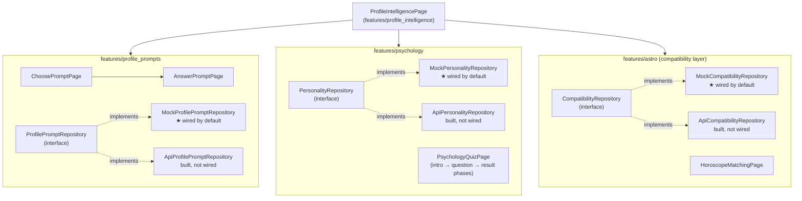

### 9.3 Feature-by-feature

| | Profile Prompts | Personality (OCEAN) | Horoscope Compatibility |
|---|---|---|---|
| Feature folder | `features/profile_prompts/` | `features/psychology/` | `features/astro/` (compatibility slice) |
| Repository interface | `ProfilePromptRepository` | `PersonalityRepository` | `CompatibilityRepository` |
| Default (active) impl | `MockProfilePromptRepository` — in-memory bank of 12 prompts across 4 categories (Personality/Marriage & Compatibility/Family/Career), seeded with 1 pre-answered prompt | `MockPersonalityRepository` — 10 dummy Likert questions (2 per OCEAN trait), computes real OCEAN scoring math client-side | `MockCompatibilityRepository` — fixed sample: 85% "Excellent Match" with 4 factor breakdown (Nakshatra/Rasi/Dosham/Personality) |
| Real (built, dormant) impl | `ApiProfilePromptRepository` → `GET /profiles/prompts/bank`, `GET`/`PUT /profiles/prompts/me` | `ApiPersonalityRepository` → `GET /psychology/quiz/active`, `GET /psychology/quiz/me`, `POST /psychology/quiz/submit` | `ApiCompatibilityRepository` → `GET /astro/profile/me`, `GET /astro/compatibility/:targetUserId` |
| Backend readiness | Endpoints exist as **stubs only** — `profiles/prompts` controllers were added in an earlier pass but the `PromptService`/`PromptRepository` are real; **needs verification** against current `backend/apps/api/src/modules/profiles/` state | **No backend module exists** — `PsychologyQuiz` is modeled in Prisma and seeded, but there's no `apps/api/src/modules/psychology/` at all | `astro` module is a stub (empty controller/service) — `CompatibilityService`/`AstroController` not implemented |
| UI entry points | Drawer → Profile Intelligence hub → "Profile Prompts" card → `ChoosePromptPage` (category chips, rounded cards) → `AnswerPromptPage` (char-limited answer) | Hub → "Personality Insights" card → `PsychologyQuizPage`, a single page with 3 internal phases: **intro** (estimated time, Start button) → **question** (one Likert question per screen, 5-point scale) → **result** (OCEAN bar chart, "Emotional Balance" label replacing raw Neuroticism = `100 - N`) | Hub → "Horoscope Compatibility" card → `HoroscopeMatchingPage` (Rasi/Nakshatra/Dosham/Birth Details display + matching-enabled toggle + sample `CompatibilityResultWidget` preview) |
| Display widgets | `core/widgets/relationship_intelligence/profile_prompt_section.dart` | `core/widgets/relationship_intelligence/psychology_section.dart` | `core/widgets/relationship_intelligence/horoscope_compatibility_section.dart` + `compatibility_result_widget.dart` |
| Where shown (read-only) | `ProfilePage`, `ProfileReviewPage` (edit mode only) | same | same |
| Minimum/maximum | 0-3 prompts (optional, never blocks anything) | Optional, no minimum | Optional opt-in toggle |

### 9.4 Data flow (mock, current state)

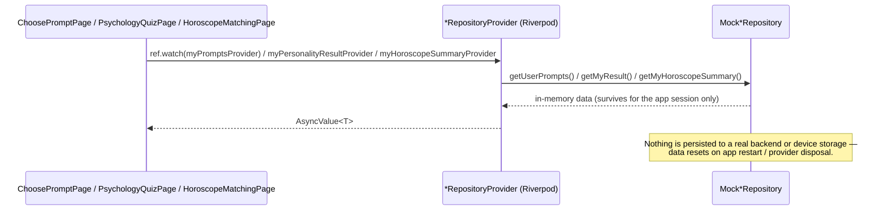

### 9.5 Path to real backend integration

To connect a real backend, per feature: (1) implement the corresponding NestJS module/controller/service (only `profiles/prompts/*` has any backend scaffolding today — psychology and astro/compatibility need to be built from scratch), (2) flip the single `Provider` override in `presentation/providers/*_provider.dart` from `Mock*Repository` to the already-written `Api*Repository`. **No UI code needs to change** — this is the entire point of the interface/mock/api split.

### 9.6 Improve-Profile one-time nudge

`discover_page.dart` watches a private `_shouldShowImproveProfilePromptProvider` (`FutureProvider.autoDispose<bool>`) that atomically checks-and-marks `StorageService.hasSeenImproveProfilePrompt`. The first time any user (new or existing) lands on Discover after this feature shipped, they're pushed to the Profile Intelligence hub once via a post-frame callback; the flag then suppresses it forever after. This is deliberately **decoupled from registration completion** — it's a device-local flag, not tied to "just finished the wizard."

---

## 10. Authentication

### 10.1 Architecture decision

Per `auth-architecture.md` (repo root): **Firebase Auth is the sole identity provider, auth-only** — no Firestore, no Firebase-side user data storage. The real profile lives in Postgres via the NestJS backend, keyed to `User.firebaseUid`.

### 10.2 Client-side flow

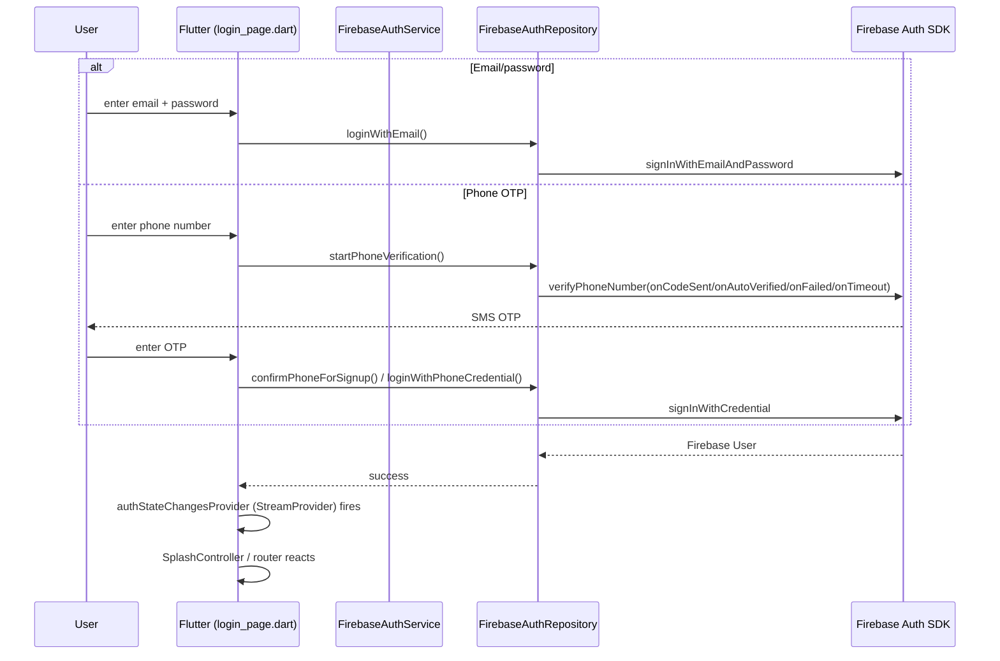

Both email/password **and** phone OTP are fully implemented, including phone-linking during signup (attaching a phone credential to an email account, tolerant of `provider-already-linked`/`credential-already-in-use` retry errors).

### 10.3 Token attachment & backend verification

Every authenticated Dio request carries `Authorization: Bearer <Firebase ID token>`, injected by `AuthInterceptor` (client-side) via `AuthTokenService.getFirebaseToken()`. On the backend, `FirebaseAuthGuard` verifies it with `firebase-admin`'s `verifyIdToken()` and JIT-provisions/resolves the internal `User` row — see the full sequence in [§5.3](#53-request-lifecycle-authenticated-request).

### 10.4 JWT status

⚠️ **`JWT_SECRET` is configured (required, validated by Joi) but currently unused.** There is no `@nestjs/jwt`/`jsonwebtoken`/`passport-jwt` dependency, `apps/api/src/modules/auth/*` is 100% stub (`TokenService`, `FirebaseTokenService`, `PasswordService`, `OtpService`, `AuthService` are all empty classes), and the `RefreshToken` Prisma model — despite a doc comment describing it as a hashed single-use refresh token store — is **never read or written** anywhere in the codebase. **Auth today is Firebase-ID-token-only, end to end.** If a custom JWT layer is ever built (e.g. for the WebSocket app, whose `WsJwtGuard` is also a stub), this is the reserved-but-dormant scaffolding for it.

### 10.5 Session restore

See [§7.2](#72-splash--session-resolution). Firebase's SDK handles ID token refresh transparently client-side — there is no app-level refresh-token exchange. On backend 401, the client does **not** force sign-out; it logs a diagnostic (`'[API] Got 401 from backend — check that the backend has real Firebase Admin credentials configured.'`) on the theory that a 401 while a Firebase session is active means backend misconfiguration, not an expired token.

### 10.6 Logout

`SettingsPage` → confirm dialog → `authRepositoryProvider.logout()` (`FirebaseAuth.signOut()`) → `context.go('/login')`. A global `ref.listen(authStateChangesProvider, ...)` in `main.dart` catches **any** sign-out path (not just this button) and resets `registrationProvider` to create-mode + clears all nav-state storage, preventing draft-state leakage across accounts on a shared device.

### 10.7 Route protection

⚠️ **No router-level guard.** No `redirect:` callback exists on the `GoRouter` instance. Protection is procedural (splash resolution + resume-check), not structural — a deep link straight into e.g. `/profile-review` would not be blocked by the routing layer itself. Flag for security review before enabling deep linking or push-notification-triggered navigation.

---

## 11. API Documentation

Base URL (dev): `http://192.168.168.109:3000` (from `Frontend/.env.dev` — a LAN IP, see [§22](#22-troubleshooting)). All endpoints below are prefixed with this base URL. **Auth column**: 🔒 = requires `Authorization: Bearer <Firebase ID token>` via `FirebaseAuthGuard`.

### 11.1 Live, implemented endpoints (`ProfilesModule`)

| Method | URL | Purpose | Auth | Request DTO | Response | Controller → Service |
|---|---|---|---|---|---|---|
| GET | `/profiles/draft` | Fetch the caller's in-progress registration draft | 🔒 | — | `RegistrationStep`-shaped JSON (`currentStep`, `totalSteps`, `completedSteps`, `isComplete`, `completionPercentage`, `data: {...}`) | `ProfileDraftController` → `ProfileDraftService.getDraft` |
| PATCH | `/profiles/draft/basic-details` | Save step 0 | 🔒 | `BasicDetailsDto` | 200 | `ProfileDraftController` → `ProfileDraftService.updateSection` |
| PATCH | `/profiles/draft/religion-details` | Save step 1 | 🔒 | `ReligionDetailsDto` | 200 | same |
| PATCH | `/profiles/draft/language-details` | Save step 2 | 🔒 | `LanguageDetailsDto` | 200 | same |
| PATCH | `/profiles/draft/location-details` | Save step 3 | 🔒 | `LocationDetailsDto` | 200 | same |
| PATCH | `/profiles/draft/education-details` | Save step 4 | 🔒 | `EducationDetailsDto` | 200 | same |
| PATCH | `/profiles/draft/physical-details` | Save step 5 | 🔒 | `PhysicalDetailsDto` | 200 | same |
| PATCH | `/profiles/draft/lifestyle-details` | Save step 6 | 🔒 | `LifestyleDetailsDto` | 200 | same |
| PATCH | `/profiles/draft/family-details` | Save step 7 | 🔒 | `FamilyDetailsDto` | 200 | same |
| PATCH | `/profiles/draft/horoscope-details` | Save step 8 | 🔒 | `HoroscopeDetailsDto` | 200 | same |
| PATCH | `/profiles/draft/partner-preference` | Save step 9 | 🔒 | `PartnerPreferenceDto` | 200 | same |
| GET | `/profiles/me` | Fetch the caller's finalized profile | 🔒 | — | `UserProfile`-shaped JSON | `ProfileController` → `ProfileService.getOwn` |
| POST | `/profiles/finalize` | Map draft → `UserProfile`/`AstrologyProfile`/`PartnerPreference` (idempotent) | 🔒 | — | 201/200 | `ProfileController` → `ProfileService.finalize` |
| GET | `/profiles/me/photos` | List the caller's photo metadata | 🔒 | — | `ProfilePhoto[]` | `PhotoController` → `PhotoService` |
| POST | `/profiles/me/photos` | Register photo metadata (no file transfer) | 🔒 | photo metadata body | 201 | `PhotoController` → `PhotoService` |

### 11.2 Endpoints referenced by the Flutter client's `Api*Repository` classes (backend stub or partial — **not confirmed reachable**)

These are called by the *dormant* `Api*Repository` implementations in `profile_prompts`/`psychology`/`astro` — wire-compatible request/response shapes were designed against them, but the owning backend controllers are stubs (`astro`, and psychology has no module at all) or **need verification** (`profiles/prompts/*`, added in an earlier iteration — recheck current backend state before relying on this table).

| Method | URL | Purpose | Backend status |
|---|---|---|---|
| GET | `/profiles/prompts/bank` | List the pickable prompt bank | Needs verification |
| GET | `/profiles/prompts/me` | Get caller's saved prompts | Needs verification |
| PUT | `/profiles/prompts/me` | Replace-all save (0-3 prompts) | Needs verification |
| GET | `/psychology/quiz/active` | Get the active OCEAN quiz | ❌ No `psychology` module exists |
| GET | `/psychology/quiz/me` | Get caller's quiz result | ❌ No `psychology` module exists |
| POST | `/psychology/quiz/submit` | Submit quiz answers | ❌ No `psychology` module exists |
| GET | `/astro/profile/me` | Self horoscope summary | 🔴 `AstroController` is an empty stub |
| GET | `/astro/compatibility/:targetUserId` | 2-person compatibility score | 🔴 `CompatibilityService` is an empty stub |

### 11.3 Defined-but-unimplemented endpoint groups (`ApiEndpoints` constants exist, no backend controller, corresponding Flutter feature is still mock UI)

| Group | Representative endpoints | Owning (stub) backend module |
|---|---|---|
| Legacy Auth | `login`, `register`, `verifyOtp`, `resendOtp`, `refreshToken`, `logout`, `forgotPassword`, `resetPassword` | `auth` — unused; real auth is Firebase-direct, see [§10](#10-authentication) |
| Profile (extended) | `profileUpdate`, `profilePhotos`, `profilePreferences`, `profileCompletion`, `profileVerification`, `profileHoroscope` | Marked "not yet implemented" in-code |
| Search & Discovery | `search`, `searchFilters`, `discover`, `recommendations`, `aiMatches` | `search`, `matches` |
| Matches | `matches`, `matchInterest`, `matchShortlist`, `matchDecline`, `matchViewed` | `matches`, `interests` |
| Chat | `conversations`, `messages` | `chat` |
| Notifications | `notifications`, `notificationSettings`, `registerDevice` | `notifications` |
| Subscription | `plans`, `subscribe`, `subscriptionStatus` | `subscription` |
| Verification | `verifyId`, `verifyPhoto`, `verificationStatus` | `verification` |
| Settings | `settings`, `privacySettings`, `deleteAccount` | `settings` |
| Support | `help`, `faq`, `contactSupport`, `reportUser` | `support` |

---

## 12. State Management

### 12.1 Provider inventory (30 total)

| Provider | Type | File | Purpose |
|---|---|---|---|
| `localeProvider` | `NotifierProvider<LocaleNotifier, Locale>` | `core/providers/locale_provider.dart` | Active app locale |
| `apiClientProvider` | `Provider<ApiClient>` | `core/network/api_providers.dart` | Shared Dio client, Firebase-token-authenticated |
| `firebaseAuthProvider` | `Provider<FirebaseAuth>` | `authentication/.../auth_providers.dart` | SDK singleton |
| `firebaseAuthServiceProvider` | `Provider<FirebaseAuthService>` | same | Auth SDK wrapper |
| `authTokenServiceProvider` | `Provider<AuthTokenService>` | same | Mints Firebase ID tokens |
| `authRepositoryProvider` | `Provider<FirebaseAuthRepository>` | same | Auth domain repository |
| `authStateChangesProvider` | `StreamProvider<User?>` | same | Reactive Firebase session stream — drives splash + logout redirects |
| `currentAuthUserProvider` | `Provider<AuthUser?>` | same | Local `AuthUser` derived from the stream |
| `loginControllerProvider` | `NotifierProvider<LoginController, bool>` | `authentication/.../login_controller.dart` | Login loading/submit state |
| `signupControllerProvider` | `NotifierProvider<SignupController, SignupState>` | `.../signup_controller.dart` | Signup flow state |
| `phoneAuthControllerProvider` | `NotifierProvider<PhoneAuthController, PhoneAuthState>` | `.../phone_auth_controller.dart` | Phone OTP flow state |
| `forgotPasswordControllerProvider` | `NotifierProvider<ForgotPasswordController, ForgotPasswordState>` | `.../forgot_password_controller.dart` | Forgot-password flow state |
| `splashControllerProvider` | `NotifierProvider<SplashController, void>` | `splash/.../splash_provider.dart` | Resolves initial route |
| `registrationRepositoryProvider` | `Provider<RegistrationRepository>` | `registration/.../registration_provider.dart` | Wizard backend calls |
| `profileFlowModeProvider` | `StateProvider<ProfileFlowMode>` | same | CREATE vs EDIT flag |
| `registrationProvider` | `NotifierProvider<RegistrationNotifier, ProfileDraft>` | same | The 12-step draft, `keepAlive` |
| `discoverMockDataSourceProvider` | `Provider<DiscoverMockDataSource>` | `discover/.../discover_providers.dart` | Mock feed data |
| `discoverRepositoryProvider` | `Provider<DiscoverRepository>` | same | Discover feed repo |
| `discoverFeedProvider` | `FutureProvider<DiscoverFeedEntity>` | same | Loads the feed |
| `discoverFilterProvider` | `StateProvider<DiscoverFilter>` | same | Active tab filter |
| `discoverProfilesProvider` | `Provider<AsyncValue<List<DiscoveryProfileEntity>>>` | same | Filtered projection |
| `_shouldShowImproveProfilePromptProvider` | `FutureProvider.autoDispose<bool>` (private) | `discover/.../discover_page.dart` | One-time hub nudge flag |
| `compatibilityRepositoryProvider` | `Provider<CompatibilityRepository>` | `astro/.../compatibility_provider.dart` | Defaults to Mock |
| `myHoroscopeSummaryProvider` | `FutureProvider.autoDispose<HoroscopeSummary>` | same | Self horoscope + opt-in |
| `compatibilityPreviewProvider` | `FutureProvider.autoDispose<CompatibilityResult>` | same | Sample compatibility result |
| `profilePromptRepositoryProvider` | `Provider<ProfilePromptRepository>` | `profile_prompts/.../profile_prompt_provider.dart` | Defaults to Mock |
| `promptBankProvider` | `FutureProvider.autoDispose.family<List<PromptBankItem>, PromptCategory?>` | same | Pickable bank, filterable |
| `myPromptsProvider` | `FutureProvider.autoDispose<List<PromptAnswer>>` | same | Saved prompt answers |
| `personalityRepositoryProvider` | `Provider<PersonalityRepository>` | `psychology/.../personality_provider.dart` | Defaults to Mock |
| `myPersonalityResultProvider` | `FutureProvider.autoDispose<PersonalityResult?>` | same | OCEAN result if taken |
| `personalityQuizProvider` | `NotifierProvider.autoDispose<PersonalityQuizNotifier, PersonalityQuizState>` | same | intro→question→result state machine |

### 12.2 Dependency graph (representative slice)

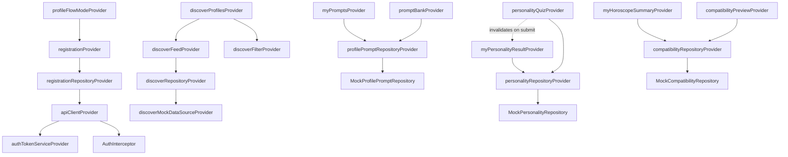

No `riverpod_generator`/`@riverpod` codegen is used anywhere despite being a `pubspec.yaml` dependency — every provider above is hand-written.

---

## 13. Navigation

### 13.1 Standalone routes (root navigator, no bottom nav)

| Path | Name | Page | Category |
|---|---|---|---|
| `/` | `splash` | `SplashPage` | Public |
| `/language` | `language` | `LanguagePage` | Public |
| `/auth-selection` | `authSelection` | `AuthSelectionPage` | Public |
| `/onboarding` | `onboarding` | `OnboardingPage` | Public |
| `/login` | `login` | `LoginPage` | Public |
| `/otp` | `otp` | `OtpPage` | Public |
| `/login-otp` | `loginOtp` | `LoginOtpScreen` | Public |
| `/verify-email` | `verifyEmail` | `EmailVerifyScreen` | Semi-protected (post-signup) |
| `/verify-phone` | `verifyPhone` | `PhoneVerifyScreen` | Semi-protected |
| `/forgot-password` | `forgotPassword` | `ForgotPasswordPage` | Public |
| `/registration` | `registration` | `RegistrationPage` | Protected (procedural) |
| `/create-profile-for` | `createProfileFor` | `CreateProfileForPage` | Protected |
| `/registration/wizard` | `registrationWizard` | `ProfileWizardPage` | Protected — registration routes |
| `/registration/psychology-quiz` | `psychologyQuiz` | `PsychologyQuizPage` | Protected — Profile Intelligence |
| `/profile-intelligence` | `profileIntelligence` | `ProfileIntelligencePage` | Protected — Profile Intelligence hub |
| `/profile-prompts/choose` | `choosePrompt` | `ChoosePromptPage` | Protected — Profile Intelligence |
| `/horoscope-matching` | `horoscopeMatching` | `HoroscopeMatchingPage` | Protected — Profile Intelligence |
| `/profile-review` | `profileReview` | `ProfileReviewPage` | Protected — registration routes |
| `/settings` | `settings` | `SettingsPage` | Protected — drawer |
| `/verification` | `verification` | `VerificationPage` | Protected — drawer |
| `/subscription` | `subscription` | `SubscriptionPage` | Protected (custom slide-up transition) |
| `/help` | `help` | `HelpPage` | Protected — drawer |
| `/privacy` | `privacy` | `PrivacyPage` | Protected — drawer (stub) |
| `/trust-score` | `trustScore` | `TrustScorePage` | Protected — drawer (stub) |
| `/visitors` | `visitors` | `VisitorsPage` | Protected — drawer (stub) |
| `/interests-sent` | `interestsSent` | `InterestsSentPage` | Protected — drawer (stub) |
| `/interests-received` | `interestsReceived` | `InterestsReceivedPage` | Protected — drawer (stub) |
| `/shortlisted` | `shortlisted` | `ShortlistedPage` | Protected — drawer (stub) |

⚠️ `RouteNames.about`/`aboutName` (`/about`) is declared but has **no corresponding `GoRoute`** — dead constant.

### 13.2 Bottom-nav shell routes

| Path | Name | Page | Visible tab icon? |
|---|---|---|---|
| `/discover` | `discover` | `DiscoverPage` | ✅ (tab 1) |
| `/search` | `search` | `SearchPage` | ❌ push-only |
| `/matches` | `matches` | `MatchesPage` | ✅ (tab 2) |
| `/messages` | `messages` | `ChatPage` | ✅ (tab 3) |
| `/notifications` | `notifications` | `NotificationsPage` | ❌ push-only |
| `/profile` | `profile` | `ProfilePage` | ❌ push-only |
| `/premium` | `premium` | `PremiumPage` | ✅ (tab 5) |
| `/astro` | `astro` | `AstroPage` | ✅ (tab 4) |

### 13.3 Deep links

Not configured — no `intent-filter`/`Info.plist` universal-link setup was found in this research pass. ⚠️ **Needs verification** against `android/app/src/main/AndroidManifest.xml` and `ios/Runner/Info.plist` directly if deep linking is a launch requirement; combined with [§10.7](#107-route-protection)'s lack of a router-level guard, this is worth a dedicated security pass before enabling.

---

## 14. Configuration

### 14.1 Frontend

- **Environment files**: `.env.dev`, `.env.qa`, `.env.staging`, `.env.production` (all registered as pubspec assets), loaded via `flutter_dotenv`. ⚠️ **`main.dart` hardcodes `AppConfig().init(AppEnvironment.dev)`** — there is no flavor/`--dart-define` switch wired up to actually select qa/staging/production at build time; switching environments today requires hand-editing `main.dart`.
- **`.env.example` keys** (Frontend): `API_BASE_URL`, `ENABLE_LOGGING`, `S3_BUCKET_NAME`, `STRIPE_PUBLISHABLE_KEY`.
- **Real root `.env`** (gitignored) additionally carries `FIREBASE_API_KEY`, `FIREBASE_APP_ID`, `FIREBASE_PROJECT_ID`, `FIREBASE_MESSAGING_SENDER_ID` — not mirrored into `.env.example`, so a new developer copying `.env.example` alone will be missing Firebase config.
- **Firebase config**: 4 per-environment option files (`core/config/firebase/firebase_options_{dev,qa,staging,production}.dart`).
- **Theme**: fully static (`core/theme/`), not server-configurable — light/dark Material 3 themes, "midnight navy + gold" palette (see [§4.6](#46-registration-flow) / theme values already covered in the tech-stack table and [§15](#15-assets)).
- **Localization**: `l10n.yaml` at repo root drives `flutter gen-l10n` (auto-runs via `flutter: generate: true`), 2 shipped languages (`en`, `ta`) out of a 10-language roadmap list in `AppConstants`.

### 14.2 Backend

Full env var reference — see [§21.3](#213-environment-variables) for the grouped table. Key points:
- `backend/.env.example` (committed) vs `backend/.env`/`.env.local` (gitignored, real secrets — `.env.local` loads with `override: true` so it wins).
- Discrete DB vars (`DATABASE_HOST/PORT/USER/PASSWORD/NAME`) are used by `AppConfigService`, while a **separate** `DATABASE_URL` is expected by the Prisma CLI/adapter path (`prisma.config.ts`, `seed.ts`) — two different config surfaces for the same database, worth keeping in sync manually.
- No `docker-compose.yml` anywhere — Postgres/Redis/Elasticsearch must be provisioned/run manually.
- **No build-flavor concept on the backend** — `NODE_ENV` (development/production/test/staging) is the only environment switch, validated by a Joi schema at boot.

---

## 15. Assets

- **Registered directories** (`pubspec.yaml`): `assets/icons/`, `assets/images/`, `assets/svg/`, `assets/animations/`, `assets/lottie/`, `assets/illustrations/`, plus the 4 `.env.*` files.
- **Actual contents**: every subfolder is essentially empty — just a `.gitkeep` — except `assets/images/placeholder.png`. **No custom fonts are bundled** (no `assets/fonts/` registration); typography comes entirely from `google_fonts` (Poppins + Inter) fetched/cached at runtime.
- **Design system source of truth**: `core/theme/` (see [§4](#4-frontend-architecture) tech-stack row and [§2](#2-tech-stack)) — midnight navy (`#1B2B4B` primary) + gold (`#C9A84C` accent) palette, Poppins for display/headline/title, Inter for body/label, a full token system (`core/theme/tokens/`: radius, elevation, touch-target, animation curves).
- **External design reference**: `nenjam ui/stitch_soulsync_matrimonial_ui_kit/` at the repo root — an HTML+PNG export from the Stitch design tool, organized per-screen (e.g. `discover_feed/`, `astro_compatibility/`, `basic_details/`). `Frontend/README.md` explicitly instructs implementers to read this before building any UI ("measure every spacing/radius/font-size/elevation/padding... ask before making assumptions"). This is a reference artifact, not shipped in the app bundle.

---

## 16. Current Features

| Status | Features |
|---|---|
| ✅ **Completed** (UI + real backend) | Firebase authentication (email + phone OTP), 12-step registration wizard + review + finalize, session/nav-state restoration |
| 🟡 **UI complete, mock/no backend** | Discover feed, Matches, Profile Intelligence (Prompts/Personality/Horoscope — architected for easy backend swap-in, see [§9.5](#95-path-to-real-backend-integration)), Settings (partial), Verification, Premium, Search, Chat, Notifications, Subscription, Help |
| 🔴 **Placeholder only** | Interests (sent/received), Privacy, Shortlist, Trust Score, Visitors |
| 🚧 **In progress / scaffolded, not reachable** | Every backend module except `profiles`: admin, astro, auth (server-side), chat, interests, matches, notifications, search, settings, subscription, support, trust-score, users, verification — plus the `worker`/`scheduler`/`websocket` apps entirely |
| ❌ **Blocked** | Photo upload (no S3 wiring on either side), Payments/checkout (provider conflict — Razorpay vs Stripe, see [§2](#2-tech-stack) — and no gateway integration exists), Real-time chat (WebSocket app is a stub), Push notifications (no FCM send path, device tokens modeled but unused) |
| 🗑️ **Deprecated / dead** | `bootstrap.dart` (vestigial duplicate entrypoint), legacy `ApiEndpoints` Auth group (`login`/`register`/`verifyOtp`/etc. — superseded by Firebase-direct auth), `MatchReelCard` widget (orphaned, no references found), `ZodValidationPipe` (stub, superseded in practice by Nest's built-in `ValidationPipe`) |

---

## 17. Known Technical Debt

*(Documented only — nothing below has been modified.)*

### 17.1 TODO / stub markers

The backend is **overwhelmingly scaffolded rather than incomplete-in-a-messy-way** — nearly every non-`profiles` file follows one of three consistent TODO patterns:
- `// TODO: implement <X> once <package> is installed` — guards/interceptors/pipes/decorators across almost every module (dozens of hits; representative: `libs/common/src/guards/roles.guard.ts:3`, `libs/common/src/filters/all-exceptions.filter.ts:3`, `modules/profiles/guards/profile-ownership.guard.ts:3`).
- `// TODO: implement with @nestjs/bullmq's @Processor once the package is installed` — every `apps/worker/src/processors/*.ts`.
- `// TODO: implement with @nestjs/schedule's @Cron once the package is installed` — every `apps/scheduler/src/cron/*.ts`.
- `it.todo('add specs once X is implemented')` — ~24 placeholder unit test files across every module.

Frontend TODO/debug markers (fewer, but worth cleaning before release):
- `Frontend/lib/main.dart` (4 spots), `core/router/app_router.dart:64`, `features/splash/presentation/pages/splash_page.dart` (2 spots) — all tagged `// TEMPORARY DIAGNOSTIC — remove after the resume/reload investigation`.
- `features/registration/presentation/pages/profile_wizard_page.dart:86` and `core/network/api_client.dart:35` — tagged `// TEMPORARY DEBUG LOGGING`, the latter logging full request/response bodies (verbose `LogInterceptor`).
- `features/astro/data/repositories/api_compatibility_repository.dart:30` — `// TODO(backend-team): no dedicated opt-in endpoint exists yet for this...`

### 17.2 "Coming Soon" placeholder pages

`interests` (sent + received), `privacy`, `shortlist`, `trust_score`, `visitors` — each ~33 lines, `Icon` + `Text('Coming Soon')`, wired into routing/drawer but with zero real content.

### 17.3 Empty/unregistered backend modules

14 of 15 `apps/api/src/modules/*` folders are fully-scaffolded-but-empty and **not imported into `AppModule`** — see the full breakdown in [§5.2](#52-appsapi-module-map). `apps/worker`, `apps/scheduler`, `apps/websocket` are similarly skeletal (infra-only module imports, every processor/cron/gateway file is a 1-line TODO stub).

### 17.4 Duplicate / orphaned / dead code

- **`Frontend/lib/bootstrap.dart`** — a near-duplicate of `main.dart`'s bootstrap logic (its own `bootstrap()` function + its own slimmer `NenjamMatrimonyApp` class), never called; only survives because `core/network/api_client.dart` imports it for the `appConfig` global.
- **`Frontend/lib/features/discover/presentation/widgets/match_reel_card.dart`** — grepped with no other references anywhere in `lib/` — appears to be dead code.
- **`nenjam ui/`** at the repo root — a large Stitch design-export tree (HTML+PNG per screen), not part of the buildable app, sitting at top level rather than in a `design/` folder or being excluded from the main repo.
- **Two root-level markdown docs** (`auth-architecture.md`, `registration-wizard-integration.md`) live outside both `Frontend/` and `backend/`, not in a `docs/` folder — fine as-is, just noting the convention for anyone adding more.
- `ZodValidationPipe` (`backend/libs/common/src/pipes/zod-validation.pipe.ts`) — unimplemented stub, `zod` package unused; the real validation mechanism is Nest's `ValidationPipe` + `class-validator`. Don't build new DTOs against the Zod pattern.

### 17.5 Legacy / superseded architecture

- `StorageService`'s access/refresh-token methods and `AuthInterceptor`'s `getRefreshToken`/`saveTokens` plumbing are full scaffolding for a token-refresh flow that Firebase's SDK already handles transparently — currently unused dead weight, not wrong, just vestigial.
- `ApiEndpoints`'s legacy Auth group (`login`, `register`, `verifyOtp`, `resendOtp`, `refreshToken`, `logout`, `forgotPassword`, `resetPassword`) — no code calls these; real auth is Firebase-direct.
- `RefreshToken` Prisma model + `JWT_SECRET` env var — modeled/configured but unused (see [§10.4](#104-jwt-status)).

### 17.6 Temporary mocks (intentional, not "debt" in the negative sense, but worth tracking to completion)

`DiscoverMockDataSource`, and the entire Profile Intelligence mock-repository layer (`MockProfilePromptRepository`, `MockPersonalityRepository`, `MockCompatibilityRepository`) — all deliberately built with a matching `Api*` counterpart ready to swap in (see [§9.5](#95-path-to-real-backend-integration)). This is the one category of "mock" in the codebase that's architected for graceful retirement rather than left as an afterthought.

### 17.7 Payment provider ambiguity

⚠️ Backend references **Razorpay** (`modules/subscription/controllers/razorpay-webhook.controller.ts`, `UserSubscription.razorpaySubId`, `PaymentTransaction.razorpayOrderId`/`razorpayPaymentId`); frontend `.env.example` references **Stripe** (`STRIPE_PUBLISHABLE_KEY`). Neither is actually wired up yet, so this hasn't caused a functional bug, but it needs a decision before building checkout. **Needs verification** with product/business ownership.

---

## 18. Backend ↔ Frontend Integration Status

| Feature | Frontend | Backend | Database | API | Notes |
|---|---|---|---|---|---|
| Firebase Auth | ✅ Complete | ✅ Complete (`FirebaseAuthGuard`) | ✅ `User` table | ✅ Guard-level, no dedicated endpoints needed | Fully working end-to-end |
| Registration wizard (12 steps) | ✅ Complete | ✅ Complete (`ProfilesModule`) | ✅ `RegistrationStep`, `UserProfile`, `AstrologyProfile`, `PartnerPreference` | ✅ 10 PATCH + finalize + draft GET | The one fully-integrated feature |
| Photo upload | 🟡 UI exists (step 10) | 🟡 Metadata endpoint only, no file transfer | ✅ `ProfilePhoto` | 🟡 Partial | S3 wiring missing both sides |
| Profile Prompts | ✅ Complete (mock) | ⚠️ Needs verification (`profiles/prompts/*` controllers exist, unclear if real) | ✅ Not in ERD shown — **needs verification** whether a `ProfilePrompt`/`UserProfilePrompt` table exists in current schema | ⚠️ Needs verification | Mock-first architecture, see [§9](#9-profile-intelligence) |
| Personality Quiz | ✅ Complete (mock) | ❌ No `psychology` module | ✅ `PsychologyQuiz`/`QuizQuestion`/`UserQuizResponse` (seeded) | ❌ None | Data model ready, zero API surface |
| Horoscope Compatibility | ✅ Complete (mock) | 🔴 `astro` module is empty stub | ✅ `AstrologyProfile`, `HoroscopeMatch` | 🔴 Stub only | |
| Discover feed | ✅ Complete (mock) | ❌ No module wired | ✅ `UserProfile` has the fields, unused for search | ❌ None | |
| Matches | 🟡 UI complete (mock) | 🔴 `matches` module empty, unregistered | ✅ Fields exist, no matching logic | 🔴 Stub | |
| Chat | 🟡 UI complete (mock) | 🔴 `chat` module empty; `websocket` app is a stub | ✅ `ChatRoom`/`ChatMessage`/`MessageReaction` | 🔴 Stub | Real-time transport (WebSocket) entirely unbuilt |
| Notifications | 🟡 UI complete (mock) | 🔴 `notifications` module empty | ✅ `Notification`/`DevicePushToken` | 🔴 Stub | No FCM send path |
| Subscription/Payments | 🟡 Placeholder UI | 🔴 `subscription` module empty | ✅ `SubscriptionPlan` (seeded), `UserSubscription`, `PaymentTransaction` | 🔴 Stub | Payment provider undecided (Razorpay vs Stripe) |
| Verification (KYC/face) | 🟡 Mock UI | 🔴 `verification` module empty | ✅ `KycVerification`, `FaceVerification` | 🔴 Stub | |
| Trust Score | 🔴 "Coming Soon" | 🔴 `trust-score` module empty | ✅ `TrustScoreLog`, `User.trustScore` | 🔴 Stub | |
| Interests / Shortlist / Visitors | 🔴 "Coming Soon" | 🔴 `interests` module empty | ⚠️ No dedicated `Interest`/`Shortlist`/`ProfileView` tables found in the ERD reviewed — **needs verification** | 🔴 Stub | |
| Search | 🟡 Mock grid UI | 🔴 `search` module empty (Elasticsearch connected but unused) | ✅ Indexable fields exist on `UserProfile` | 🔴 Stub | |
| Admin | N/A (no admin UI in this Flutter app) | 🔴 `admin` module empty | ✅ `AdminAccount`, `AuditLog`, seeded default admin | 🔴 Stub | |
| Support | 🟡 Mock FAQ UI | 🔴 `support` module empty | ✅ `SupportTicket` | 🔴 Stub | |

---

## 19. Production Readiness

| Area | Status | Detail |
|---|---|---|
| **Core registration flow** | 🟢 Production-plausible | Real DB writes, real auth, an actual e2e test (`profile-ownership.e2e-spec.ts`) covering auth rejection, data isolation, mass-assignment protection, idempotent finalize |
| **Security — route guards** | 🔴 Gap | No router-level auth guard on the Flutter side ([§10.7](#107-route-protection)); no global exception filter on the backend (stub); `ZodValidationPipe` stub unused but harmless since Nest's `ValidationPipe` is active |
| **Security — secrets hygiene** | 🟡 Mixed | Real Firebase secrets found in root `.env` not mirrored to `.env.example` — fine as long as `.env` stays gitignored (verify this), but the example files are misleadingly incomplete for onboarding |
| **Performance / caching** | 🔴 Not implemented | Redis is connected but nothing caches through it; no HTTP response caching, no query result caching |
| **Rate limiting** | 🔴 Not implemented | `otp-rate-limit.guard.ts` and `razorpay-signature.guard.ts` are both stubs; no `@nestjs/throttler` or equivalent found |
| **Monitoring / logging** | 🔴 Not implemented | `LoggerService` and `AllExceptionsFilter` are both empty stubs; no APM/error-tracking (Sentry, etc.) integration found on either side |
| **CI/CD** | 🔴 Not implemented | No `.github/workflows/`, no other CI config found anywhere in the repo |
| **Testing** | 🔴 Minimal | Backend: 1 real e2e suite + a handful of infra-lib unit tests; every feature-module unit spec is `it.todo()`. Frontend: 1 smoke test only, no widget/unit test suite despite a documented intended structure in `Frontend/BRAIN.md` |
| **Deployment** | 🔴 Not defined | No `docker-compose.yml`, no Dockerfile found in this pass (**needs verification** — not exhaustively searched for a `Dockerfile` specifically), no documented deployment target (server host, container registry, etc.) |
| **Search infra** | 🟡 Provisioned, unused | Elasticsearch connected + index mapping defined, but `SearchModule` empty |
| **Queue infra** | 🔴 Not installed | BullMQ package absent; all async job/cron logic is TODO-stubbed |
| **Payments** | 🔴 Blocked | Provider undecided (Razorpay vs Stripe), no gateway integration on either side |
| **Real-time (chat/presence)** | 🔴 Not implemented | `websocket` app is a stub app; no `socket.io`/`@nestjs/websockets` dependency |

---

## 20. Folder Ownership

| Folder | Primary owner | Notes |
|---|---|---|
| `Frontend/lib/core/theme/`, `core/constants/`, `assets/` | **UI/Design + Frontend dev (shared)** | Design tokens should be driven by the Stitch export in `nenjam ui/`; changes here ripple everywhere |
| `Frontend/lib/features/registration/` | **Frontend dev** | Coordinate closely with backend on `ProfilesModule` DTO shape changes |
| `Frontend/lib/features/{profile_prompts,psychology,astro,profile_intelligence}/` | **Frontend dev** | Mock-first; backend dev only needs to build matching endpoints then flip one provider override each (see [§9.5](#95-path-to-real-backend-integration)) |
| `Frontend/lib/core/network/`, `core/router/`, `core/services/` | **Frontend lead / architecture owner** | Cross-cutting — changes here affect every feature |
| `Frontend/lib/l10n/` | **Frontend dev + translators** | ARB files need translator review, not just code review |
| `backend/apps/api/src/modules/profiles/` | **Backend dev** | The one real vertical — treat as the reference pattern for building out the other 14 |
| `backend/apps/api/src/modules/{admin,astro,auth,chat,interests,matches,notifications,search,settings,subscription,support,trust-score,users,verification}/` | **Backend dev** | Empty scaffolds — this is most of the remaining backend work |
| `backend/libs/database/prisma/` | **Backend dev (DB owner)** | Schema changes require a migration + regenerating the client; coordinate with whoever owns seed data |
| `backend/libs/{cache,search,queue}/` | **Backend/DevOps (shared)** | Infra is provisioned; actually wiring caching/search/queues into feature services is a backend task, but the underlying Redis/ES/queue infrastructure choice is a DevOps concern |
| `backend/apps/{worker,scheduler,websocket}/` | **Backend dev** | Needs `bullmq`, `@nestjs/schedule`, and `@nestjs/websockets`+`socket.io` installed before any real work can start here |
| Env files, `docker-compose.yml` (to be created), CI config (to be created) | **DevOps** | No compose file or CI exists yet — greenfield DevOps work |
| `nenjam ui/` | **UI Designer** | Reference-only; keep in sync with Figma/Stitch source, not application code |
| `Frontend/test/`, `backend/apps/api/test/`, `backend/**/*.spec.ts` | **QA + respective devs** | Test infrastructure is set up on both sides but coverage is minimal — a good first QA-driven initiative |

---

## 21. Development Workflow

### 21.1 Running the frontend

```bash
cd Frontend
flutter pub get          # also triggers `flutter gen-l10n` (flutter: generate: true)
flutter run               # standard debug run; no build flavors are wired up
```

⚠️ `main.dart` hardcodes `AppEnvironment.dev`, which loads `.env.dev` → `API_BASE_URL=http://192.168.168.109:3000` (a LAN IP). **Update this IP to match whatever machine is actually running the backend**, or the app will fail to reach it (see [§22](#22-troubleshooting)).

### 21.2 Running the backend

```bash
cd backend
pnpm install               # runs `prisma generate` automatically via postinstall
cp .env.example .env       # then fill in real DATABASE_*/REDIS_*/ELASTICSEARCH_*/JWT_SECRET/FIREBASE_* values
pnpm prisma:migrate:deploy  # or prisma:migrate:dev during active schema work
pnpm db:seed                 # seeds subscription plans, OCEAN quiz, default admin
pnpm start:dev                # nest start api --watch, port 3000
```

**Required external services** (none containerized — provision manually):
- PostgreSQL (`DATABASE_HOST`/`PORT`/`USER`/`PASSWORD`/`NAME`, **and** a separate `DATABASE_URL` for the Prisma CLI — keep both in sync)
- Redis (`REDIS_HOST`/`REDIS_PORT`) — dev-mode tolerates it being unreachable (warns, continues); prod-mode fails fast
- Elasticsearch (`ELASTICSEARCH_NODE`) — same dev-lenient/prod-strict pattern
- Firebase Admin credentials (`FIREBASE_PROJECT_ID`/`FIREBASE_CLIENT_EMAIL`/`FIREBASE_PRIVATE_KEY`) — optional at boot, but every `FirebaseAuthGuard`-protected route will 500 without them

Other apps (only meaningful once their respective npm packages are installed and real logic is built):
```bash
pnpm start:worker      # apps/worker — no HTTP port, background process
pnpm start:scheduler   # apps/scheduler — no HTTP port
pnpm start:websocket   # apps/websocket — port 3001
```

### 21.3 Environment variables

| Group | Backend | Frontend |
|---|---|---|
| Runtime | `NODE_ENV`, `PORT` (3000), `WEBSOCKET_PORT` (3001) | `API_BASE_URL`, `ENABLE_LOGGING` |
| Database | `DATABASE_HOST`, `DATABASE_PORT` (5432), `DATABASE_USER`, `DATABASE_PASSWORD`, `DATABASE_NAME` (+ separate `DATABASE_URL` for Prisma CLI) | — |
| Cache/Search | `REDIS_HOST`, `REDIS_PORT`, `REDIS_PASSWORD` (optional); `ELASTICSEARCH_NODE` | — |
| Email | `SMTP_HOST`, `SMTP_PORT`, `SMTP_USER` (optional), `SMTP_PASSWORD` (optional) | — |
| Auth | `JWT_SECRET` (unused today, see [§10.4](#104-jwt-status)) | Firebase config files (per-environment `firebase_options_*.dart`) |
| Firebase (backend admin) | `FIREBASE_PROJECT_ID`, `FIREBASE_CLIENT_EMAIL`, `FIREBASE_PRIVATE_KEY` (all optional at boot) | `FIREBASE_API_KEY`, `FIREBASE_APP_ID`, `FIREBASE_PROJECT_ID`, `FIREBASE_MESSAGING_SENDER_ID` (in root `.env`, **not** in `.env.example`) |
| Logging | `LOG_LEVEL` | — |
| Storage/Payments | — | `S3_BUCKET_NAME`, `STRIPE_PUBLISHABLE_KEY` (see [§17.7](#177-payment-provider-ambiguity) for the Stripe/Razorpay conflict) |

### 21.4 Ports

| Service | Port |
|---|---|
| Backend API | 3000 |
| Backend WebSocket app | 3001 |
| PostgreSQL | 5432 (default, per `.env.example`) |
| Redis, Elasticsearch | whatever `REDIS_PORT`/`ELASTICSEARCH_NODE` specify — no defaults committed |

### 21.5 Common commands

| Task | Command |
|---|---|
| Backend: dev server with hot reload | `pnpm start:dev` (in `backend/`) |
| Backend: run migrations (dev) | `pnpm prisma:migrate:dev` |
| Backend: run migrations (prod) | `pnpm prisma:migrate:deploy` |
| Backend: open Prisma Studio (DB GUI) | `pnpm prisma:studio` |
| Backend: reseed | `pnpm db:seed` |
| Backend: lint | `pnpm lint` |
| Backend: unit tests | `pnpm test` |
| Backend: e2e tests | `pnpm test:e2e` |
| Frontend: install + codegen | `flutter pub get` |
| Frontend: run | `flutter run` |
| Frontend: analyze | `flutter analyze` |
| Frontend: build APK | `flutter build apk` |

---

## 22. Troubleshooting

| Symptom | Likely cause | Fix |
|---|---|---|
| Flutter app can't reach the backend (`DioException`, connection refused/timeout) | `API_BASE_URL` in `.env.dev` points to a stale LAN IP (`192.168.168.109`) that isn't the machine actually running `pnpm start:dev`, or the device/emulator isn't on the same network | Update `Frontend/.env.dev`'s `API_BASE_URL` to the current host's LAN IP (or `10.0.2.2` for the Android emulator talking to `localhost`); restart the app after editing `.env.dev` since dotenv is loaded once at startup |
| Backend won't start — Joi validation error on boot | A required env var is missing (`DATABASE_HOST`, `DATABASE_PORT`, `DATABASE_USER`, `DATABASE_PASSWORD`, `DATABASE_NAME`, `REDIS_HOST`, `REDIS_PORT`, `ELASTICSEARCH_NODE`, or `JWT_SECRET` < 16 chars) | Copy `backend/.env.example` → `.env`, fill in every required key; check `libs/config/src/validation.ts` for the exact Joi schema if the error message is unclear |
| Every `FirebaseAuthGuard`-protected endpoint returns 500 | `FIREBASE_PROJECT_ID`/`FIREBASE_CLIENT_EMAIL`/`FIREBASE_PRIVATE_KEY` not set — Firebase Admin never initialized | Set all three; note `FIREBASE_PRIVATE_KEY`'s `\n` sequences must be literal backslash-n in the env file (the code unescapes them at load time) |
| Prisma errors on `pnpm prisma:migrate:dev`/`deploy` | `DATABASE_URL` (separate from the discrete `DATABASE_HOST/PORT/...` vars) not set, or out of sync with them | Prisma CLI/adapter path reads `DATABASE_URL` specifically — make sure it's set and matches the discrete vars |
| Seed script fails on the admin user | Nothing wrong with the seed itself, but the seeded admin (`admin-seed-placeholder-uid-001`) can't actually log in | Create a real Firebase Console user and manually update the seeded `AdminAccount`/`User.firebaseUid` to match, or edit `admin.seeder.ts` before running |
| Flutter build errors after pulling new `l10n` changes | ARB files changed but generated `AppLocalizations` wasn't regenerated | Run `flutter gen-l10n` explicitly, or just `flutter pub get` again (auto-triggers it since `generate: true`) |
| A route "does nothing" or shows a blank screen | You hit one of the "Coming Soon" stub pages (interests/privacy/shortlist/trust_score/visitors) or a mock-data page with no-op buttons | Check [§16](#16-current-features) / [§18](#18-backend--frontend-integration-status) before assuming it's a bug — many screens are intentionally unimplemented placeholders right now |
| Registration wizard doesn't save a step | The section's JSON was empty (nothing filled in) — `_patchSection()` deliberately skips the network call in that case | Not a bug; fill in at least one field for that step, or check `RegistrationRepository._patchSection` if you need to change this behavior |
| Backend 401 on a request even though the user is logged in | Backend's Firebase Admin credentials aren't configured (see the 500-error row above) or the client's Firebase ID token genuinely expired and hasn't refreshed yet | Check backend logs for the Firebase Admin init error; the client itself won't force a re-login on 401 (see [§10.5](#105-session-restore)) so you may need to manually restart the app to force a fresh token |

---

## 23. Future Roadmap

*(Inferred from current architecture and stub scaffolding — **needs verification** against an actual product roadmap/backlog, which was not found in the repo.)*

### Phase 1 — Close the loop on what's already scaffolded
- Wire real endpoints for **Profile Prompts** (verify/complete `profiles/prompts/*`), build the missing **`psychology` module** from scratch, and implement the **`astro`** compatibility service — then flip the 3 `Provider` overrides in the Flutter app ([§9.5](#95-path-to-real-backend-integration)). This is the lowest-effort, highest-payoff phase since the frontend and DB schema are already done.
- Implement photo upload end-to-end (S3 presigned URLs or direct upload + `PhotoController` wiring).
- Register at least `matches`, `interests`, `search` in `AppModule` and build minimal real logic — these unblock the core matrimony value proposition (finding and expressing interest in matches).

### Phase 2 — Real-time & notifications
- Install `@nestjs/websockets`+`socket.io`, implement `ChatGateway`/`WsJwtGuard`/`PresenceService`, connect `apps/websocket`.
- Install `@nestjs/bullmq`, wire the `worker` app's processors (photo compression/moderation, push fanout, search indexing).
- Install `@nestjs/schedule`, wire the `scheduler` app's crons (trust-score decay, subscription expiry, inactive-profile nudges).
- Build real push notification sending (FCM) against the already-modeled `DevicePushToken`/`Notification` tables.

### Phase 3 — Monetization & trust
- **Resolve the Razorpay vs Stripe question**, then implement subscription checkout + webhook handling.
- Implement KYC/face verification (`VerificationModule`) against the modeled `KycVerification`/`FaceVerification` tables.
- Implement trust-score computation logic against `TrustScoreLog`.
- Build the `admin` module (moderation, user management, verification review) — `AdminAccount`/`AuditLog` are already modeled and seeded.

### Phase 4 — Hardening for launch
- Add a global exception filter, structured logging (replace the `LoggerService` stub), and error monitoring/APM.
- Add rate limiting (especially on OTP send and any public-facing endpoints).
- Add router-level auth guards on the Flutter side; audit deep-link handling.
- Stand up CI (lint + test on PR at minimum) and a deployment pipeline (`docker-compose.yml` for local parity, then a real deploy target).
- Fill out actual test coverage (both backend `it.todo` specs and Flutter widget/unit tests) — current coverage is minimal on both sides.
- Remove the flagged debug scaffolding (`TEMPORARY DIAGNOSTIC`/`TEMPORARY DEBUG LOGGING` markers, `bootstrap.dart`, `match_reel_card.dart`).
- Decide and implement the actual environment/flavor-switching mechanism for the Flutter app (currently hardcoded to dev).

**Recommended order rationale**: Phase 1 leverages the huge amount of frontend/DB work already done for Profile Intelligence and core browsing (matches/search) — it converts existing investment into a usable product fastest. Phase 2 is needed for basic matrimony-app table-stakes (talking to a match). Phase 3 is what makes the business model work. Phase 4 is what makes any of the above safe to put in front of real users at scale.

---

## 24. Architecture Diagrams (Index)

All diagrams are embedded inline near their relevant section; this is an index for quick navigation.

| Diagram | Location |
|---|---|
| Backend monorepo structure | [§5.1](#51-monorepo-shape) |
| `apps/api` module registration map | [§5.2](#52-appsapi-module-map) |
| Authenticated request lifecycle (sequence) | [§5.3](#53-request-lifecycle-authenticated-request) |
| `ProfilesModule` internal flow | [§5.4](#54-profilesmodule--the-one-real-vertical) |
| Database ER diagram | [§6.1](#61-entity-relationship-diagram) |
| New-user journey (flowchart) | [§7.1](#71-complete-flow-new-user) |
| Post-login navigation graph | [§7.3](#73-navigation-graph-post-login) |
| Frontend bootstrap sequence | [§4.1](#41-bootstrap-sequence) |
| Profile Intelligence module map | [§9.2](#92-module-map) |
| Profile Intelligence mock data flow (sequence) | [§9.4](#94-data-flow-mock-current-state) |
| Client-side auth flow (sequence) | [§10.2](#102-client-side-flow) |
| Riverpod provider dependency graph | [§12.2](#122-dependency-graph-representative-slice) |

---

## 25. Completion Summary & Launch Plan

*(All percentages are estimates derived from the code inventory in this document, not a formal audit — treat as directional, and mark as **needs verification** if used for external reporting.)*

### 25.1 Completion percentages

| Area | Estimate | Basis |
|---|---|---|
| **Overall project completion** | **~35%** | Weighted across frontend UI (further along), backend (far behind), and the fact that "launchable" requires both |
| **Frontend completion** | **~75%** | Nearly every screen exists and is polished (theme, navigation, localization all solid); the gap is wiring real data instead of mocks, not building UI |
| **Backend completion** | **~15%** | 1 of 15 API modules is real; infra (DB/Redis/ES/Firebase-auth) is genuinely solid, but feature logic is almost entirely absent |
| **Database completion** | **~90%** (schema) / **~20%** (utilization) | Schema is comprehensive and well-indexed for the whole domain; most tables have no API surface reading/writing them yet |
| **Production readiness** | **~20%** | Core auth + registration path is genuinely solid; nearly everything else (security hardening, monitoring, CI/CD, testing, deployment, payments) is missing |

### 25.2 Remaining work before launch (grouped by priority)

**High priority** (blocks any real launch):
1. Build the `matches`/`interests`/`search` backend modules — a matrimony app without match-browsing/expressing-interest isn't functional.
2. Implement photo upload end-to-end.
3. Resolve and implement payments (pick Razorpay or Stripe, wire subscription checkout).
4. Add router-level auth guards on the Flutter side; add a real global exception filter + structured logging on the backend.
5. Stand up CI (at minimum: lint + `flutter analyze` + backend `pnpm test` on every PR) and a documented deployment process.

**Medium priority** (needed for a good v1, not strictly launch-blocking):
1. Finish the Profile Intelligence backend (psychology module from scratch, astro compatibility service, verify prompts endpoints) — frontend is ready and waiting.
2. Real-time chat (WebSocket app + BullMQ worker for message fanout).
3. Push notifications (FCM send path).
4. Trust score computation + verification (KYC/face) module.
5. Rate limiting on auth-adjacent endpoints (OTP send especially).
6. Real test coverage on both sides (replace `it.todo` stubs; add Flutter widget tests).

**Low priority** (polish / nice-to-have):
1. Admin module (moderation/user management UI is out of scope for this Flutter app anyway — likely a separate admin web app, **needs verification**).
2. Additional localization languages (8 more roadmapped: hi, gu, te, kn, ml, mr, bn, ar).
3. Clean up flagged debug scaffolding and dead code ([§17](#17-known-technical-debt)).
4. Environment/flavor-switching mechanism for the Flutter app.
5. Support module (FAQ/tickets) real backend.

### 25.3 Suggested development order

1. **Matches + Interests + Search backend** (High #1) — unlocks the core loop.
2. **Photo upload** (High #2) — profiles are much less useful without photos.
3. **Profile Intelligence backend completion** (Medium #1) — cheapest win, frontend already done.
4. **Payments** (High #3) — needed to validate the monetization model early, even before full launch polish.
5. **Security/observability hardening** (High #4-5) — do this *before* opening to real users, not after.
6. **Real-time chat + notifications** (Medium #2-3) — significant new infra (WebSocket, BullMQ) but high user-facing value.
7. **Trust/verification** (Medium #4) — differentiator feature, can follow the core loop.
8. **Testing, CI/CD, deployment pipeline** — should really be threaded through *all* of the above rather than done last, but is called out explicitly here in case it's being deprioritized.
9. **Polish/low-priority items** — once the above is stable.

---

*End of document. This handbook reflects a point-in-time read of the repository; re-generate or update it as the codebase evolves, especially the [§18](#18-backend--frontend-integration-status) integration matrix and [§25](#25-completion-summary--launch-plan) completion estimates.*
