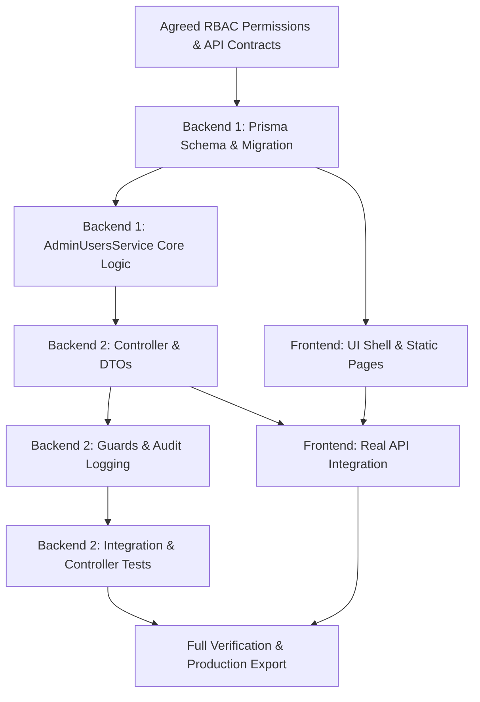

# Nenjam Matrimony Admin Panel — User Management Module Consolidated Handoff

**Primary Audience:** Engineering Team, QA, & Staff Operations  
**Contributors:**  
- **Shaaz Alfaiz** (Backend Developer 1 — Database & Core Domain Service)  
- **Backend Developer 2** (API, Controllers, DTOs, Security, Integration Tests)  
- **Dhatri** (Frontend Developer 1 — Admin Web Console)  
**Date:** 10 November 2026  
**Status:** Implemented, Tested, & Verified  

---

## 1. Executive Summary & Flow

The User Management module provides Nenjam Matrimony operations and customer support staff with full administrative control over member accounts. The implementation enforces strict Role-Based Access Control (RBAC), immutable audit logging, sensitive PII protection, and real-time Redis cache invalidation for blocked sessions.



---

## 2. Completed Deliverables

### A. Backend 1 (Shaaz Alfaiz — Database & Core Domain)
1. **Prisma Schema & Migrations**:
   - Added `BLOCKED` to the `UserStatus` enum.
   - Created `MemberNote` model for internal staff notes with author metadata.
   - Generated and deployed migration `20261110070820_add_user_status_blocked_and_member_notes`.
   - Regenerated Prisma Client (`@prisma/client v7.8.0`).
2. **`AdminUsersService` Business Logic** (`backend/apps/api/src/modules/admin/services/admin-users.service.ts`):
   - **`listUsers`**: Server-side pagination (1-based, default 20), case-insensitive search (UUID, email, phone, name), filtering (gender, status, membership, profile completeness, registration date ranges), and sorting.
   - **`getStats`**: Real-time aggregate metrics (total registered, active, blocked, registered today, incomplete profiles, premium members).
   - **`getUserDetails`**: Comprehensive 9-tab profile data structure with masked PII by default.
   - **`blockUser` & `unblockUser`**: Atomic database transactions updating user status, creating immutable audit trail records, and triggering Redis cache invalidation (`invalidateCachedUserId`) for instant session termination (403 Forbidden).
   - **`revealPii`**: Secure PII reveal helper verifying step-up auth and recording `member.pii.reveal` audit logs with reason.
   - **`addNote`**: Helper adding internal staff notes to member profiles.
3. **Unit Tests**:
   - 15 unit tests passing in `apps/api/src/modules/admin/services/admin-users.service.spec.ts`.

---

### B. Backend 2 (API, Controllers, DTOs & Security)
1. **HTTP Controller** (`backend/apps/api/src/modules/admin/controllers/admin-users.controller.ts`):
   - Registered under `@AdminController('admin/users')` in `AdminModule`.
   - Implemented all 7 required endpoints:
     - `GET /admin/users` (`member.view`)
     - `GET /admin/users/stats` (`member.view`)
     - `GET /admin/users/:id` (`member.view`)
     - `PATCH /admin/users/:id/block` (`member.suspend`)
     - `PATCH /admin/users/:id/unblock` (`member.suspend`)
     - `POST /admin/users/:id/reveal-pii` (`member.pii.reveal` + TOTP step-up ≤10 min)
     - `POST /admin/users/:id/notes` (`member.view`)
2. **DTOs & Validation** (`backend/apps/api/src/modules/admin/dto/admin-users.dto.ts`):
   - `AdminUserListQueryDto` (with `AdminUserListDto` alias) with class-validator decorators and boolean query parameter transforms.
   - `BlockUserDto`, `UnblockUserDto`, `CreateMemberNoteDto`, and `RevealPiiDto`.
3. **Security Context & Audit Trail**:
   - Injected `@CurrentAdmin()` and `@AdminContext()` (IP address, user agent, request ID) for end-to-end audit traceability.
4. **Automated Tests**:
   - 8 controller unit tests in `apps/api/src/modules/admin/controllers/admin-users.controller.spec.ts`.
   - Supertest integration test suite in `apps/api/src/modules/admin/tests/admin-users.integration.spec.ts`.
5. **API Documentation**:
   - Published contract in `docs/admin-user-management-api-handoff.md`.

---

### C. Frontend 1 (Dhatri — Admin Web Console)
1. **Navigation & Permissions**:
   - Configured route `/users/` in `admin/src/lib/permissions.ts` guarded by `member.view` under the "Membership" group.
2. **Static Export Architecture Alignment**:
   - Aligned with Next.js `output: 'export'` static site generation requirements by using query-parameterized views (`/users/view/?id=...`), matching existing console pages (`/agents/view/`, `/payouts/view/`, `/subscriptions/view/`).
3. **User Directory Page** (`admin/src/app/(console)/users/page.tsx`):
   - **Metric Cards**: Interactive status tiles for Total Registered, Active, Blocked, Registered Today, Incomplete Profiles, and Premium Members that toggle directory filters on click.
   - **Search & Filters**: Debounced/form search, gender, status, membership tier, profile completeness, and sorting controls.
   - **Data Table**: Columns for member name/ID, demographics, location, masked contacts, membership badge, profile completion %, account status badge, registration date, and actions.
   - **Quick Actions**: Inline View button and Block/Unblock dialogs with required reason capture.
4. **User Profile Detail Page** (`admin/src/app/(console)/users/view/page.tsx`):
   - **Header**: Status badge, registration date, trust score, ID copy, and action buttons (`Back to Members`, `Reveal PII`, `Block User` / `Unblock User`).
   - **Tab Navigation**:
     - **Basic Info**: Profile overview, masked/unmasked contact information, warning notice when PII is unmasked.
     - **Matrimony Profile**: Religion, caste, mother tongue, education, employment, income, family background, horoscope (rashi, nakshatra, manglik status).
     - **Partner Preferences**: Age, height, marital status, education, location, and dietary requirements.
     - **Membership & Payments**: Active subscription details, validity dates, plan tier, and transaction history.
     - **Photos & Verification**: Primary photo, gallery, and government ID / selfie verification status badges.
     - **Activity & History**: Login history, IP addresses, user agents, device types, and audit events.
     - **Internal Notes**: List of chronological staff notes with author attribution and an inline form to submit new notes.
   - **Step-Up PII Reveal**: Modal confirming admin reason before calling `POST /admin/users/:id/reveal-pii` and displaying unmasked contacts without persisting them in local storage.

---

## 3. How Components Connect

```
┌────────────────────────────────────────────────────────┐
│               Admin Web Console (Next.js)              │
│  /users/ (Directory)       /users/view/?id=... (Detail)│
└───────────────────────┬────────────────────────────────┘
                        │ HTTP / JSON
                        ▼
┌────────────────────────────────────────────────────────┐
│             AdminUsersController (NestJS)              │
│  @RequirePermissions('member.view' | 'member.suspend') │
└───────────────────────┬────────────────────────────────┘
                        │
                        ▼
┌────────────────────────────────────────────────────────┐
│               AdminUsersService (Core)                 │
│  - Multi-condition queries (Prisma)                    │
│  - PII masking / unmasking                             │
│  - Transactional Audit Logger (AdminAuditService)      │
│  - Redis Auth Cache Invalidation (invalidateCachedUser)│
└───────────────────────┬────────────────────────────────┘
                        │
            ┌───────────┴───────────┐
            ▼                       ▼
┌───────────────────────┐ ┌───────────────────────────────┐
│  PostgreSQL (Prisma)  │ │      Redis Session Cache      │
│  - users              │ │  - Immediate session discard  │
│  - member_notes       │ │    on user block (403 denied) │
│  - admin_audit_logs   │ └───────────────────────────────┘
└───────────────────────┘
```

---

## 4. Verification & Testing Guide

### 1. Running Backend Unit Tests
From the project root:
```powershell
cd backend
npx jest admin-users
```
**Expected Result**:
- `admin-users.controller.spec.ts`: 8 tests passing.
- `admin-users.service.spec.ts`: 15 tests passing.
- 0 failures.

### 2. Building the Backend
```powershell
cd backend
npx nest build api
```
**Expected Result**: Webpack compiles cleanly with 0 errors.

### 3. Running Admin Frontend Tests
```powershell
cd admin
npm test
```
**Expected Result**: All 37 vitest tests pass.

### 4. Building the Admin Console (Static Export)
```powershell
cd admin
npm run build
```
**Expected Result**: Next.js exports 20/20 static pages including `/users` and `/users/view` with 0 type errors.

---

## 5. Manual QA Checklist

| Step | Action | Expected Behavior |
|---|---|---|
| 1 | Navigate to `/users/` | Directory loads with aggregate stats tiles and member table. Contacts are masked (`+91 98***210`, `ka***@gmail.com`). |
| 2 | Click on a stats tile (e.g. "Blocked Users") | Filters table automatically to `status=BLOCKED`. Clicking again resets filter. |
| 3 | Search by name or email | Table updates with filtered results according to server-side query. |
| 4 | Click "View" or member name | Opens `/users/view/?id=<uuid>` with complete 9-tab profile view. |
| 5 | Click "Reveal PII" button | Prompts for audit reason. After submission, displays unmasked phone & email with a warning banner. Creates `member.pii.reveal` audit record. |
| 6 | Click "Block User" | Prompts for mandatory reason. Updates status badge to `BLOCKED`, revokes user's active session via Redis, and creates `member.suspend` audit log. |
| 7 | Add internal note under "Internal Notes" tab | Saves new note, prepends it to the notes list immediately with current staff member's name and timestamp. |
| 8 | Click "Unblock User" | Restores account status to `ACTIVE` and records audit entry. |

